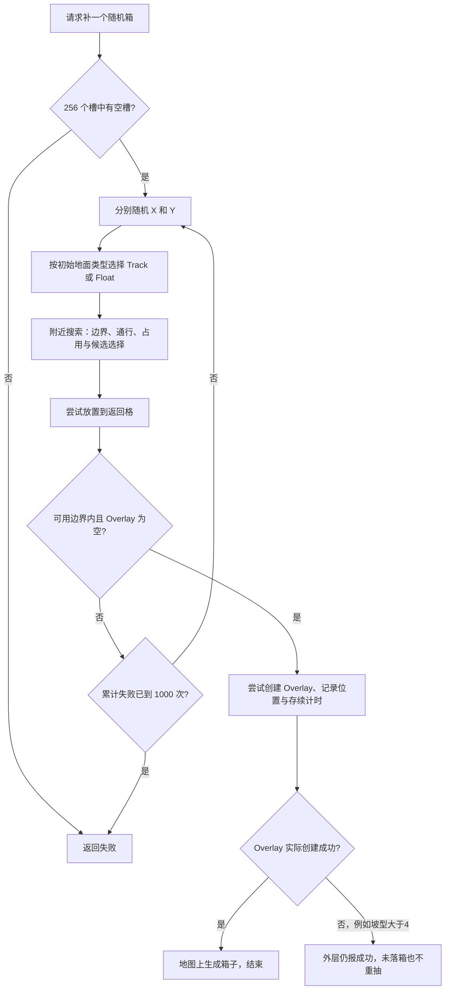

# 红警 2 随机工具箱的坐标生成与失败处理

> 本文保留机制研究时的阶段记录。“本机研究记录”所指反汇编、截图和实验输出不随源码或便携包分发；示例中的 `local-research` 也须由研究者自行准备。当前已支持的功能和模型边界以 [真实地图说明](../REAL-MAPS.md) 为准，启动与打包见 [README](../README.md)。

更新日期：2026-10-13。用途：为机制介绍视频提供可复查的结论、流程和演示素材。

研究对象是遭遇战／多人游戏的**随机工具箱补充流程**。分别检查了本地原版红警 2 `game.exe` 和尤里的复仇 `gamemd.exe` 的磁盘指令，并用尤复反编译归档、YRpp 类型定义和 Phobos 的实际 Hook 源码交叉解释。地图预放箱子、触发器造箱、摧毁单位掉箱及奖励抽取不是同一入口，不能把本报告的完整流程直接套用过去。第 6.1 节另对照了地图触发及建筑 `CrateBeneath` 入口，解释建筑废墟引发的失败。

## 1. 可以直接用于视频的结论

**游戏先随机选一个起点，再在起点附近找可用格，最后尝试放箱。只有这次放箱失败，才重新随机起点。** 原版 RA2 和原版 YR 在本题的关键规则上一致。

1. 初始 X、Y 分别从一个包围地图的正方形范围里抽取，不是先列出全部合法空地再等概率选一个。
2. 初始点可以落到实际地图外，也可以落到 `LocalSize` 可用边界以外。原版不会仅因初始点越界就立即重抽，仍进入附近搜索。
3. 附近搜索从原格开始，按方形环向外扩展；普通地图最多检查半径 0～31 格。找到候选后，原格可能被替换为附近的格子。
4. **“地图可用边界外”和“玩家没有探索的黑幕”是两回事。** 前者会被几何边界条件排除；后者不构成这条生成链的否决条件。镜头是否滚动到该位置也不参与判断。
5. 地面单位、建筑基础、树木等会通过占用标志或通行性影响附近搜索。空中画面与地面格子重叠，不能直接等同于地面占用。
6. **已有箱子与单位占格的处理并不相同。** 附近搜索没有开启“禁止所有覆盖物”；标准箱子可能通过这一层，随后因最终放置要求 `OverlayTypeIndex == -1` 而失败。这时整轮重抽起点，不是在这个箱子旁继续找。
7. 单次随机放箱调用最多执行 **1000 轮“随机起点 → 附近搜索 → 放置”**。全部失败则返回失败，不保证一定补出一个箱子。
8. 边界外起点可能被附近搜索挪到边缘，因而**初始坐标的均匀抽样不等于最终落点均匀**。Phobos 专门改过这部分逻辑；录制原版机制时应确认没有加载该修改。
9. **“能通行”仍不保证箱子 Overlay 能落下。** `SlopeIndex > 4` 的坡型另有拒绝条件，而箱子外层没有传播这次 Overlay 创建失败，会结束本次生成且记录槽位。不能把这种情况算成普通重抽，详见 6.2。本结论来自两版机器码控制流，尚未做实机断点复现。

依据：下文 E01～E08 的本地二进制、E09 的反编译归档及 E10 的插件源码。

## 2. 各种坐标与占用情况会怎样

表中的“附近搜索”指原版 `NearByLocation`；“重抽”指回到外层，再调用两次有界随机数生成 X、Y。

| 抽中的位置或选出的候选格 | 附近搜索阶段 | 最终结果与下一步 |
| --- | --- | --- |
| 初始点在 `Size` 定义的实际地图外，但仍在初始抽样正方形内 | 不会仅据此立刻重抽；围绕该点找符合可用边界的格子 | 31 圈内找到可放位置就可能成功；找不到则本轮失败，重抽 |
| 初始点对应的格子指针不存在，或线性索引越过数组范围 | 使用 `InvalidCell` 哨兵；其构造默认 `LandType=Clear(0)`，因此正常状态走 Track 陆地搜索 | 仍需找到可用边界内、通过通行与放置检查的格子；不会因为地图边缘是海水就改用 Float。见 4.1.1 |
| 在完整地图内，但在 `LocalSize` 可用边界外 | 该格不能成为合格候选；搜索可向边界内推进 | 可能被挪进可用区，也可能找不到而重抽 |
| 在可用区，玩家尚未探索，处于黑幕或战争迷雾下 | 这条生成链不以玩家探索状态筛选候选 | 只要通行、占用、覆盖物等条件满足，仍能生成；玩家暂时看不到 |
| 在可用区，但不在当前屏幕内 | 不检查镜头范围 | 可以正常生成 |
| 可用、可通行、无占用、无覆盖物的普通空地 | 半径 0 就能找到原格 | 通常就在初始格放箱 |
| 树木、岩石对象、建筑基础、坦克／步兵等占格 | 对应占用字节不为零时，该格不进入候选；继续附近搜索 | 可能放到附近空位；不会清除、挤走、摧毁原有物体 |
| 悬崖、不可通行地形、与所选移动类型不兼容的地面 | 通行倍率为零等条件使该格被排除 | 搜索附近兼容格；若无结果，重抽 |
| 标准围墙、沙袋墙、铁丝网等 `Wall=yes` 的覆盖物 | 本入口用 `MovementZone::Normal`，在通行检查中拒绝 | 继续附近搜索；不是矿石／旧箱子的“最后才失败”路径 |
| 可通行、无占用的普通坡面，`SlopeIndex=1～4` | 不因“不能盖普通建筑”而统一拒绝；仍检查高度边界、通行与候选投影 | 满足剩余条件且 Overlay 为空时可以放箱 |
| 可通行、Overlay 为空但 `SlopeIndex>4` 的坡面 | 可以通过附近搜索 | 实际 Overlay 创建被拒绝，但 Put 仍报成功、外层停止；此格没有实际箱子，见 6.2 |
| 已有标准工具箱 | 箱子是 Overlay；通常不占单位／建筑占用位，且其陆地或水域属性能通过所选通行检查，因此可能成为候选 | 最终发现已有 Overlay，拒绝叠放，外层重抽；不会覆盖或合并旧箱子 |
| 矿石等可通行 Overlay | 可能通过附近搜索 | 最终因 Overlay 非空而失败，外层重抽；矿区不能简单描述成“附近搜索会自动挑旁边的无矿格” |
| 原版 `LeaveRubble` 留下、没有其他占用的建筑废墟 | 基础格有 `RUBBLE_OVERLAY`；标准规则下可通过 Track 通行检查，可能成为候选 | 最终因 Overlay 非空而失败；随机入口重抽起点，地图触发入口本次返回失败。不是在废墟旁继续搜，见 6.1 |
| 仅有弹坑、烧痕等 Smudge，或单位图像的一部分覆盖该格 | 不能仅凭画面判定占用；最终条件只明确禁止 Overlay，未直接禁止 Smudge | 看该格真实通行性和占用数据；不是所有可见装饰都会挡箱 |
| 地图上确有可用空地，但距本次起点超过搜索范围 | 本轮搜索不会无限扩大到整张地图 | 本轮仍可能失败；下一轮重新抽点后才可能找到它 |
| 256 个原生箱子管理槽全部非空 | 入口先扫描槽位 | 直接返回失败，连 X、Y 都不抽 |

其中普通地面占用的依据是 `CellClass::IsClearToMove`，不是“把所有图像检测一遍”。建筑只在实际基础占格处构成相应阻挡；飞行器、桥上／桥下单位、悬浮对象是否写入被检查的占用层，要按实际状态区分。**本报告不把“屏幕上有东西”当作充分条件。**

## 3. 初始坐标怎样随机

### 3.1 范围是 Cell 坐标的包围正方形

设地图 `[Map] Size=0,0,W,H`。在正常地图创建路径中，程序初始化：

```text
MapCoordBounds 的前两项 = 1, 1
MapCoordBounds 的后两项 = W + H - 1, W + H - 1
```

随机放箱入口实际使用：

```text
x = 第 1 项 + RandomRanged(0, 第 3 项 - 1)
y = 第 2 项 + RandomRanged(0, 第 4 项 - 1)
```

因此，对上述正常初始化的地图：

```text
x ∈ [1, W + H - 1]
y ∈ [1, W + H - 1]
```

上下界均包含。比如 `Size=0,0,64,64`，第一次抽点共有 `127 × 127 = 16129` 个整数坐标对。这里是游戏的 Cell 坐标空间，不是屏幕像素，也不是把地图当成 64×64 的普通直角网格。

这些坐标中有不少不在实际菱形地图内。完整地图的 `CoordinatesLegal` 条件，在正常原点为零的地图上相当于：

```text
x + y > W
x - y < W
y - x < W
x + y ≤ W + 2H
```

初始抽点函数没有先套用这四条条件。也没有先要求初始点处于 `LocalSize`。这正是后续附近搜索能够把“外围抽样概率”转移到边缘的原因。

证据：YR `0x56631C～0x566338`、RA2 `0x548BEC～0x548C08` 初始化范围；YR `0x56BD8B～0x56BDD3`、RA2 `0x54E45B～0x54E4A3` 抽 X、Y；YR `0x568300` 是完整地图范围检查。见 E01、E06。

### 3.1.1 外围坐标是否多出整行、整列

**就原版随机起点的范围而言，demo 没有漏掉额外的一行或一列，也没有在真实地图和外围坐标之间留空。** 地图内外共用连续的整数 Cell 坐标；初始抽样范围恰好是实际地图在 Cell X／Y 方向上的最小包围正方形。

由上面四条合法条件可得，真实格子的 X、Y 最小值均为 1，最大值均为 `W+H-1`。例如 `(1,W)` 与 `(W,1)` 是真实格，`(W+H-1,H)` 与 `(H,W+H-1)` 也是真实格，因此抽样上下界没有额外向外扩一格。X／Y 的行列在游戏画面上是斜向的，不能直接当作屏幕水平行、垂直列。

对于 demo 的 `W=8,H=6`：

- 初始抽样为 `1≤X≤13、1≤Y≤13`，共 169 对坐标；其中 90 对对应完整地图的真实格。
- 不包含 `X=0`、`Y=0`、`X=14`、`Y=14` 这些额外行列。逐行、逐列枚举可确认 1～13 的每一行、列都至少有一个真实格。
- 地图内外的格子沿同一网格直接相接。例如 `(4,5)` 在地图内，紧邻的 `(4,4)` 在地图外，没有夹一条未显示的格子带。
- 外围不是只有一圈：抽样正方形中未通过完整地图条件的坐标都可能成为初始点；投影到屏幕后，形成地图四周的大片区域。

还须区分三件事：**附近搜索**会计算 `起点±半径`，可能检查到 0、负数或大于 13 的坐标；**内部 Cell 指针表**有 512×512 个索引槽，但不等于每个槽都有真实地形，也不是随机起点范围；**红色矩形线**是菱形格的外包络，精确合法边沿呈锯齿状，某些无效格的部分菱形可以进入这个矩形的角落。demo 的初始抽样与合法格判定均与上述规则一致。

复核依据：RA2 `0x548BEC～0x548C08`、`0x54E45B～0x54E4A3`；YR `0x56631C～0x566338`、`0x568300`。另外，YR 创建格子的循环虽然遍历了更大的索引范围，但在 `0x56637C～0x5663AD` 先应用同样的四条几何条件，越界即跳到 `0x566420`，不会因此额外创建整行、整列地形。2026-10-13 重新核对本地二进制哈希和 50 个证据锚点，并枚举 demo 的边界行列；本次未发现需要修改 demo 几何或重导视频的问题。

### 3.2 使用同步的场景随机数状态

两次有界抽样都使用 `ScenarioClass` 中偏移 `+0x218` 的随机数对象。它不是屏幕坐标的随机抖动，也不是每次使用当前真实时间重新播种。

在 YR `0x65C7E0` 中，可见有界随机数采用位掩码加超范围拒绝重取，最终返回“下界 + 区间内结果”。所以一次 `RandomRanged` 调用可能消耗不止一次底层随机数；不要在视频里说成“每次尝试恰好消耗两个随机数”。准确说法是：**每轮生成起点调用两次有界随机函数**，后续成功放置时还会为箱子的存续时间抽样。

原版 RA2 对应有界随机函数为 `0x6388A0`。两份程序均可见 250 项状态表的异或更新和相同的有界取样结构。此处只解释调用方式，不宣称实际一局中连续样本数学独立，也不把固定种子等同于任意操作后都获得相同箱子位置。

## 4. 附近搜索不是无限寻路

### 4.1 根据初始格决定陆地或水上搜索

原版查看初始格的 `LandType`：

```text
LandType == Water（枚举值 2） → SpeedType::Float（5）
其他                              → SpeedType::Track（1）
```

随后搜索一个 1×1 的位置。相关参数是：`MovementZone::Normal`、区域编号 `-1`、不忽略单位占用、`disallowOverlay=false`、`requireBurrowable=false`、`allowBridge=true`、`closeTo=Empty`。YR 还有末尾 `buildable=false` 参数；RA2 对应函数少这个参数，本入口涉及的结果不因这项差异改变。

“水箱概率”因此不是在这里先掷一次固定概率的硬币，而是受到初始格地面类型、两类移动方式的可通行格和搜索结果影响。最终采用陆地箱图像还是水箱图像，再按**最终格**的 `LandType` 决定。

标准规则中的 `Water` 允许 Float、不允许 Track；`Clear` 则相反。`Rock`、`Beach` 等按其倍率分别处理。桥梁有专门的通行例外和占用层，因此“水点永远只能落到纯水格”“允许桥梁就一定生成在桥面”都不是本报告支持的简化。

### 4.1.1 可视边界外的陆海属性，以及地图外的默认类型

**有影响：初始格是否为水，决定这一轮附近搜索使用的移动类型；最终格是否为水，决定实际创建哪种箱子。** 两次判断读取的是不同阶段的格子，不能合并成“先抽陆地箱或海洋箱，再找地方”。

| 初始坐标所在区域 | 读取的地面类型 | 搜索行为 |
| --- | --- | --- |
| `Size` 内、`LocalSize` 外的真实水格 | 该格自身的 `LandType=Water(2)` | 用 `Float(5)` 找可用边界内的兼容位置；初始格本身因边界不合格，不能直接落箱 |
| `Size` 内、`LocalSize` 外的真实非水格 | 该格自身的非 Water 类型 | 用 `Track(1)` 找可用边界内的兼容位置 |
| 正常地图的真实格子范围外，取不到 Cell | 默认占位格 `InvalidCell` 的 `LandType=Clear(0)` | 用 `Track(1)` 搜索；不会读取最近海岸的类型，也不会在搜索途中自动改成 Float |
| 可用区内，只是被玩家黑幕／迷雾遮住 | 真实格子的陆海属性照常有效 | 可以在原格或附近生成；玩家是否探索不决定陆海类型 |

地图外这一结论来自实际构造代码，不是根据画面颜色推测：

1. YR `0x565060` 把 `0xABDC50` 作为对象地址调用 `CellClass` 构造函数 `0x47BBF0`。构造函数先在 `0x47BC00` 清零 EBX，再在 `0x47BC93` 将其写入对象的 `+0xEC` 字段，即 `LandType=0`。RA2 对应全局对象为 `0xA6F9F8`，初始化入口 `0x547930`，构造函数 `0x470F10`，清零与写入分别在 `0x470F20`、`0x470FB3`。
2. 随机放箱入口按 `y*512+x` 索引取 Cell；索引越界或指针为空时改用上述占位格，并更新它的坐标。YR `0x56BE07` 选择占位格，紧接着 `0x56BE0C` 比较 `LandType` 是否为 2；RA2 对应 `0x54E4D7`、`0x54E4DC`。这个过程没有“找最近真实格并继承地形”的步骤。
3. 普通地图创建路径按完整地图的四条几何条件分配真实 Cell，见 YR `0x566368～0x566420`；地图创建／调整函数结束前也重新构造占位格。故完整地图外的默认无效格走非水分支。枚举名称 `Clear=0`、`Water=2` 与 [YRpp GeneralDefinitions.h](https://github.com/Phobos-developers/YRpp/blob/phobos-dev/GeneralDefinitions.h) 对照。
4. 最终放置时重新读取**最终格**的 `+0xEC`：YR `0x4A1944～0x4A1952`、RA2 `0x493B24～0x493B32`。值为 2 取水箱配置，否则取陆地箱配置。可用边界检查在此之前，默认 Clear 并不意味着地图外能真的放下陆地箱。

一个便于视频说明的例子：平地、无桥、标准通行规则下，初始点落在地图外，而搜索范围内的可用区全是普通海水。该轮按 Track 检查，海水通不过，所以不会“顺手放一个水箱”；搜索和放置失败后，外层重新抽 X、Y。下一轮若抽中真实水格，才会按 Float 搜索。反过来，初始点在可视边界外的真实海水里，也不会因附近陆地更近就自动改用 Track。

上述默认类型结论适用于本文核对的原版初始化路径。入口实际依据 Cell 指针和其字段分支；若插件改变占位格、创建额外越界 Cell 或修改采样／通行规则，应按修改后的代码判断，不能把“所有程序状态中的几何越界坐标都强制变成 Clear”作为引擎规则。第 11 节的交互演示现已加入本节的陆海分支，限定为标准规则的平地、无桥场景。

证据：E01、E05、E06、E12；RA2 与 YR 的占位格构造及初始／最终判断指令均已对本地二进制复核。

### 4.2 搜索顺序、范围和候选选择

原版 `NearByLocation` 的关键顺序为：

1. 半径 `r=0`，从初始格开始。
2. 若尚未找到足够合适的候选，扩大到 `r=1、2……` 的方形环。
3. 每圈先遍历 `y-r` 与 `y+r` 两条边，对每个 X 偏移依次检查两边；再遍历 `x-r` 与 `x+r` 两条边的内部部分，避免重复角点。
4. 每个格都要过可用边界和通行／占用检查；候选数组最多收集 24 项。
5. 一圈结束后若已有通过地形投影检查的候选就停止；达到 24 项也停止。若只有投影不匹配的候选，还可能继续外扩。
6. 优先使用地形投影检查能返回原格的候选组；没有这类候选才使用另一组。默认 `closeTo=Empty` 时，取 `CurrentFrame % 该组候选数量` 指向的那项。

在平坦、无桥的示例里，地形投影检查通常不改变格子，因此可以直观地理解为“在首先找到可用格的那圈中挑一个”。复杂高差中，不能省略上述候选分组与继续外扩的条件。投影辅助函数 YR `0x6D6410` 会参考格子高度及桥梁相关标志；它不是对玩家探索状态的检查。

循环上限是 `min(MapRect.Width + MapRect.Height, 32)`，且比较条件为严格小于，所以普通地图的半径是 **0～31**，而非包含第 32 圈。“31 格”指 Cell X／Y 方向的方形环半径，即切比雪夫距离，不是屏幕像素或直线距离。

**没有连通性保障。** 本入口把区域编号设为 `-1`，通行检查不要求候选和初始点属于同一移动连通区，也没有检查任何玩家单位能否走到箱子那里。符合局部条件的孤岛／隔离区域不能仅因玩家到不了就判定不会出箱。

证据：E02、E03、E04。尤复对应函数 `0x56DC20`；RA2 对应 `0x5502E0`。默认选择候选的取模指令分别在 YR `0x56E6A8` 附近、RA2 `0x550BDC` 附近。

## 5. “可视区域”到底检查了什么

### 5.1 检查地图可用边界，不检查玩家视野

附近搜索调用 `IsWithinUsableArea(cell, true)`，最后放置还会调用它的坐标版本。YRpp 对应地址为 `0x578540` 和 `0x578460`；二进制实现读取地图尺寸、`VisibleRect`、格子高度和坡面数据。没有读取玩家的 `ShroudCounter`、`Visibility`、`Foggedness`，也没有传入“哪个玩家”的参数。

设运行时 `VisibleRect=(L,T,VW,VH)`，`W` 为完整地图的 Width。该矩形由 `LocalSize` 经引擎裁剪得到，不能对任意地图都直接照抄文件数值（见 5.3）。在平地、无边缘坡面修正的情形中，可用区域条件为：

```text
x + y > W + 2T
x + y ≤ W + 2(T + VH) + 2
x - y < 2(L + VW) - W
y - x < W - 2L
```

`checkLevel=true` 还会用格子 `Level` 修正前两条和式边界；靠上边缘且有坡面的格子可能再加 1。因而上述平地公式不能不加说明地用于山地边界。

视频中应区分以下概念，不再把“可视”和“可用”当作同义词：

| 名称 | 意义 | 是否阻止生成 |
| --- | --- | --- |
| 完整地图边界 | `Size` 定义的实际地图范围 | 初始点可在外；最终要满足更具体的可用边界检查 |
| 地图可用边界 | 引擎裁剪后的 `LocalSize`，逐格带高度修正 | 附近搜索和最终放置会检查 |
| 镜头可显示范围 | 镜头滚动边界允许画出的区域，包括顶部部分不可用地面 | 不作为落箱许可；能看见仍可能不可用 |
| 玩家黑幕、战争迷雾或当前镜头 | 某玩家的探索状态及屏幕位置 | 此生成链不据此否决 |

### 5.2 占用检查也不等于“这里能不能盖房子”

`IsClearToMove` 读取普通占用层或桥梁的另一占用层。本入口对“忽略步兵”“忽略车辆”均传 false，因此对应占用字节只要非零就拒绝。

YRpp 的占用位定义列出了步兵子格／Terrain、单位、飞机、建筑等位；二进制实际拒绝条件是占用字节，而不是按所属阵营、是否隐形、玩家是否看得见逐一判断。隐形地面单位若仍占据该层，照样影响候选。

随后还要检查阻挡通行的墙类 Overlay，以及 `GroundType[LandType].Cost[SpeedType]` 是否非零。地图地面“不可建造”本身不是这一入口的统一否决条件。例如标准规则中某些地面 `Buildable=no`，但 Track 倍率非零；最后是否能放，还要看 Overlay 和其他条件。

### 5.3 顶部“看得见但不能移动／建造”的区域

**这是镜头显示范围与地图可用边界不重合的情况。就随机箱候选而言，它与其他可用边界外的真实格一样被拒绝；但它仍有真实地面属性，与完整地图外的 InvalidCell 不同。** 不能把屏幕上能看见的地面一律纳入热力图的合法落点。

这不是仅凭地图截图作出的判断。镜头位置约束函数 YR `0x6D8640`（本机研究记录：`yr-006D8640.asm.txt`） 和 RA2 `0x6A8C80`（本机研究记录：`ra2-006A8C80.asm.txt`） 都使用以下上限位置公式，其中 `screenH` 为游戏战术视口高度：

```text
镜头中心可达到的最小 Y = screenH / 2 + 15 × (W + 2T - 5)
```

而平地可用格要求 `x+y > W+2T`。镜头公式额外有 `-5`，按该投影标尺对应向上延伸 75 像素。这证明镜头可以露出可用边界外的一段地形；**75 像素是公式的偏移量，不是所有地图都恰好有固定几整行不能走**。格心位置、菱形轮廓、高度、坡面、黑幕和视口大小会影响实际可见形状。[YRpp TacticalClass](https://github.com/Phobos-developers/YRpp/blob/phobos-dev/TacticalClass.h) 的 `SetTacticalPosition` 地址也与本地调用链一致。

其他系统对这条边界的使用进一步解释了“看得见但不能走／盖”的现象：

- 格子通行属性重算 `0x483C80`（本机研究记录：`yr-00483C80.asm.txt`）先调用 `IsWithinUsableArea(coords,true)`，越界就写入 `Passability=7` 并返回。这条分支没有把 `LandType` 改成海水或陆地。
- 单位鼠标动作 `0x700600`（本机研究记录：`yr-00700600.asm.txt`）在 `0x700AF6` 检查同一可用边界，失败转到不能移动的结果；通常建造格检查 `0x47C620`（本机研究记录：`yr-0047C620.asm.txt`）在 `0x47C880` 也检查它。
- 随机箱在附近搜索和最终放置时均检查可用边界。因此，即使这片区域事先已有地图对象，也不使自动落箱合法；最终箱子辅助函数还明确将 `IKnowWhatImDoing` 临时置 0，不能拿地图初始化／预放对象的宽松条件代替它。

| 区域 | 可否成为随机起点 | 初始陆海属性 | 可否成为最终落点 |
| --- | --- | --- | --- |
| 顶部画得出来、但在可用边界外的真实格 | 在初始抽样范围内就可以 | 读取真实 Cell；水用 Float，其余用 Track | 不可以；继续附近搜索 |
| 同样位于完整地图内、可用边界外，但镜头看不到的真实格 | 可以 | 同上 | 同上 |
| 完整地图外，取不到真实 Cell | 可以 | 正常初始化的 InvalidCell 默认 Clear，因此用 Track | 不可以；继续附近搜索 |
| 可用边界内，只有玩家黑幕／迷雾或不在当前镜头 | 可以 | 真实 Cell | 可以，继续检查占用等条件 |

例如 `W=64,H=64,VisibleRect=(2,4,60,54)` 的平地图，`(36,36)` 的 `x+y=72`，虽属于完整地图却不满足严格的 `>72`；`(36,37)` 的和为 73，满足上边界条件。若前者是水，起点仍会启动 Float 搜索，不能把它改成陆地哨兵。

高度处理应直接复现二进制，而不是再划一条固定宽度“顶部禁区”。令 `k=Cell.Level`；如果 `SlopeIndex!=0` 且 `x+y < k+W+2T+4`，先令 `k=k+1`，再检查：

```text
x+y > k+W+2T
x+y ≤ k+W+2(T+VH)+2
x-y < 2(L+VW)-W
y-x < W-2L
```

另一个真实地图解析细节是 `LocalSize` 的运行时裁剪。YR `0x567230`（本机研究记录：`yr-00567230.asm.txt`）／RA2 `0x549AE0`（本机研究记录：`ra2-00549AE0.asm.txt`）先求输入矩形与完整地图矩形的交集，再按顺序执行：

```text
L  = max(L, 2)
T  = max(T, 2)
VW = min(VW, W-L-2)
VH = min(VH, H-T-6)
```

所以当前 demo 的 `8×6`、`(1,1,6,3)` 是为了放大展示而设的**合成微型几何模型**：直接把这些值作为有效矩形，未模拟原版最小边距裁剪。它不是把这个超小地图文件直接交给原版后会得到的边界；也还没有独立绘出顶部镜头余量。本次修正文档中的适用范围，不改变现有平地 demo 的内部概率模型。真实地图功能必须读取／重建裁剪后的矩形，并区分显示范围与可用掩码。

## 6. 已有箱子为什么可能直接触发重抽

必须把两个判断分开。

**附近搜索：** 传入 `disallowOverlay=false`。所以 `OverlayTypeIndex != -1` 本身不会在这一层统一排除格子；仍会检查墙、通行和占用。

**最终放置：** 箱子放置函数内部再次检查可用边界，随后明确要求目标格 `OverlayTypeIndex == -1`。不是空 Overlay 就返回 false，既不会覆盖旧箱子，也不会覆盖矿石等其他 Overlay。

例如初始点正好是已有标准陆地箱的格子，其 `Land=Clear` 且没有单位／建筑占用。半径 0 即可选中这个格子；最终放置因 Overlay 已存在而失败。调用者收到 false 后，直接转入第 2 次随机起点。**不会记住这个失败格、恢复刚才的搜索，再从半径 1 找起。**

对比：若初始点是一辆占地坦克，坦克的占用标志在附近搜索期间就让该格被拒绝，搜索可以继续到第 1 圈。两种情况最后都可能出现在别的位置，但内部路径不同。

关键指令：

| 步骤 | RA2 | YR |
| --- | --- | --- |
| 对候选调用箱子放置函数 | `0x54E556 → 0x4939A0` | `0x56BE88 → 0x4A17C0` |
| 最终创建路径的边界检查 | `0x493AF5 → 0x55A660` | `0x4A1915 → 0x578460` |
| 检查 `OverlayTypeIndex == -1` | `0x493B0F` | `0x4A192F` |
| 失败计数并准备重新随机 | `0x54E55F～0x54E566` | `0x56BE91～0x56BE98` |

标准规则的 `[CRATE]`、`[WCRATE]` 是 `Crate=yes` 的 Overlay，分别使用 `Land=Clear` 和 `Land=Water`。此处引用本地 rules 的类型说明；没有用当前 INI 代替二进制分支取证。

### 6.1 建筑废墟：为什么触发造箱失败，而随机造箱会重抽

**结论：原版建筑废墟属于“可通过附近搜索、但不能最终放箱”的情况。选中废墟格后，随机箱本轮失败并重新抽 X、Y；地图触发造箱则结束这次调用，返回失败。** 这与用户观察到的“单位会让箱子挪到附近，废墟却直接失败”一致。这里指原版 `LeaveRubble` 产生的废墟，且该格没有其他单位占用、满足边界及通行条件。

#### 废墟占的是 Overlay，而不是一栋仍然站着的建筑

建筑销毁后的处理遍历基础格，逐格写入 `Cell.OverlayTypeIndex = 0xEF`（十进制 239），并重新计算格子属性；基础原点额外保存 `Cell.Rubble` 建筑类型指针，用于废墟图像。**因此不能只找 `Cell.Rubble != nullptr` 的那一格来判断整片废墟**，其他基础格的 Overlay 也会挡箱。图像超出基础格的部分则不能直接视为占用。

本地原版 rules.ini（本机研究记录：`rules.ini`） 与尤复原始资源／补丁中的规则一致，关键设置如下；尤复来源与散列见 规则摘录（本机研究记录：`rubble-stock-rulesmd.json`）。

```ini
[RUBBLE_OVERLAY]
;Land=Rock
NoUseTileLandType=true
DrawFlat=true
IsRubble=yes
```

`Land=Rock` 是被注释掉的行，并未生效。Overlay 类型构造函数将 Land 初始化为 `Clear=0`、Wall 初始化为 false；`NoUseTileLandType=true` 使格子重算时使用覆盖物的地面类型。标准 Clear 的 Track 通行倍率是 100%。所以完成销毁、没有其他占用的普通废墟格，并不会像完整建筑那样仅因“有废墟”就被 Track 搜索跳过。`IsClearToMove` 此路径没有另行读取 `IsRubble` 或 `Cell.Rubble` 来拒绝废墟。

INI 列表写的是 `243=RUBBLE_OVERLAY`，但按 `[OverlayTypes]` 实际条目顺序从 0 数，它是第 239 项，与机器码的 `0xEF` 一致；不能把 INI 左侧编号直接当成运行时数组下标。[YRpp CellClass](https://github.com/Phobos-developers/YRpp/blob/phobos-dev/CellClass.h) 和 [OverlayTypeClass](https://github.com/Phobos-developers/YRpp/blob/phobos-dev/OverlayTypeClass.h) 用于交叉确认字段含义，最终判断依据本地指令与规则。

#### 两种入口如何分叉

指定航路点的触发动作 108（`0x6C`）调用指定位置放箱入口，内部做一次附近搜索，再调用同一个箱子槽的 Put。附近搜索仍不禁止所有 Overlay。它没有随机入口的 1000 轮重抽循环。

| 起点／选出的格子 | 地图触发指定位置放箱 | 随机放箱 |
| --- | --- | --- |
| 被地面单位占用 | 在附近搜索时排除该格，继续找；找到可最终放箱的格子才成功 | 同样先附近搜索，放置失败还可重抽 |
| 无其他占用的标准废墟格 | 可以在半径 0 选回原格；最终 Overlay 非空，返回失败 | 同样最终失败；回到外层重新随机 X、Y |
| 附近搜索从其他起点选中废墟 | 最终失败，不恢复刚才的搜索 | 本轮失败，重抽；不继续刚才的下一圈 |
| 废墟上另有单位／不可通行状态 | 先按实际占用／通行条件排除，可能搜索到别处 | 同样；不能泛化成“只要起点有废墟就一定走最终失败” |

例如 A 是无单位的可用废墟格，B 是旁边空格。指定 A 放箱并不会先判断“废墟不能放，所以改选 B”；附近搜索已经在半径 0 找到 A，最终才失败。随机入口也是如此，但它会再抽一个新的全局起点。**废墟不会被箱子覆盖或清除，失败本身也不会把 A 加入黑名单。** 后续重抽仍可能再次选到这片废墟；最多 1000 轮均失败时，随机入口也结束失败。

建筑 `CrateBeneath` 掉箱在本地两版中调用的也是上述指定位置入口，而非随机补箱入口。销毁函数里，创建废墟的分支位于调用 `CrateBeneath` 之前。若最终搜索选回废墟格，仍会被 Overlay 检查拒绝；若当时另有占用使附近搜索移到其他格，则按那一格的情况判断。不能仅依据建筑同时配置 `LeaveRubble=yes` 与 `CrateBeneath=yes` 就跳过实际落点检查，也不能给它套上随机箱的 1000 次重抽。

#### 可复查的二进制位置

| 证据 | RA2 `game.exe` | YR `gamemd.exe` |
| --- | --- | --- |
| 销毁后写废墟 Overlay | 函数 0x43EBA0（本机研究记录：`ra2-0043EBA0.asm.txt`），写入点 `0x43EC6C` | 函数 0x441F60（本机研究记录：`yr-00441F60.asm.txt`），写入点 `0x44202C`；反编译（本机研究记录：`yr-00441F60.c.txt`） |
| 触发动作调用指定位置入口 | 0x6B2830（本机研究记录：`ra2-006B2830.asm.txt`）：`0x6B2854 → 0x54E580` | 0x6E38B0（本机研究记录：`yr-006E38B0.asm.txt`）：`0x6E38D7 → 0x56BEC0`；主动作分派的内联路径（本机研究记录：`yr-006DF690.asm.txt`）同样调用 |
| 指定位置只搜索、放置一次 | 0x54E580（本机研究记录：`ra2-0054E580.asm.txt`）：Put 失败跳 `0x54E6C8` 返回 false | 0x56BEC0（本机研究记录：`yr-0056BEC0.asm.txt`）：Put 失败跳 `0x56C00A` 返回 false；反编译（本机研究记录：`yr-0056BEC0.c.txt`） |
| `CrateBeneath` 调用同一指定位置入口 | `0x43EE48`、`0x43EE61 → 0x54E580` | `0x442208`、`0x442221 → 0x56BEC0` |
| 最终拒绝非空 Overlay | `0x493B0F` | `0x4A192F`；在 Overlay 构造前即返回 false |
| 随机入口失败后重抽 | `0x54E55F～0x54E566` | `0x56BE91～0x56BE98` |

YR 的 Overlay 类型默认值（本机研究记录：`yr-005FE250.asm.txt`）（Land 字段 `+0x298`）、格子属性重算（本机研究记录：`yr-0047D2B0.asm.txt`）及前述 E03／E04 通行检查共同说明废墟为什么能成为候选。新增核查脚本（本机研究记录：`verify_rubble_evidence.py`）检查两版调用目标、条件分支、字段写入和规则；结果存入 废墟证据清单（本机研究记录：`rubble-evidence-manifest.json`）。这是静态取证，尚未做实机断点复现。

#### 对概率热力图的含义

在保留废墟的静态布局中，**废墟基础格的最终生成概率为 0，但它必须保留在符合通行条件的附近搜索候选里**。选中后计入本轮失败，再由有限重抽公式处理。这与普通可通行矿石／已有箱子的两阶段模型相同，不能把废墟简单标成“搜索不可达”，也不能先从候选中删掉、把概率直接分给旁边空格。

废墟可能占据首个非空环的一部分甚至全部候选，使更外圈的空地在本轮根本不被访问；因此其影响不止“把自身着色清零”。若将来加入 demo 或实际地图解析，应分开维护“附近搜索可通过”和“最终可放箱”两组状态，并保留重抽及同一逻辑帧的处理。当前 demo 未新增废墟场景，本次只补充机制与实现约束。

本节不把弹坑／烧痕 Smudge、尚未完成销毁的建筑、仍是 BuildingClass 的模组残骸或仅有残骸图像的地形统称为同一种废墟。修改 `RUBBLE_OVERLAY` 的 Land／Wall 等属性或安装更改放箱检查的插件后，应按实际规则重新判断。已核对的 [Phobos 采样 Hook](https://github.com/Phobos-developers/Phobos/blob/develop/src/Misc/Hooks.Crates.cpp)仍调用相同参数的附近搜索并跳回原版 Put；这段 Hook 本身没有将废墟预先排除。

### 6.2 围墙、斜坡、树木／信号灯与矿石钻井

本节同时核对原版两份可执行文件、三个 stock rules 来源和两个 stock art 来源；摘录与散列见 Terrain 规则证据（本机研究记录：`terrain-stock-rules.json`）。结论指相应原版对象，地图内覆盖规则或插件可能改变结果。

#### 围墙：在附近搜索期间排除

原版 `GASAND`、`GAWALL`、`NAWALL`、`CAFNCB`、`CAFNCW` 都是 `Wall=yes` 的 Overlay。`IsClearToMove` 在 YR `0x483598`／RA2 `0x478858` 读取 Wall；随机箱使用的移动区类型是 `Normal=0`，不在允许跨墙的分支里。因此空的围墙格也不能成为候选，搜索继续检查其他格／其他圈。可碾压、所有者、是否有血条都不会让本入口改用碾墙移动区。

**围墙不是“和矿石一样，等到最终 Overlay 非空才重抽”。** 同时，附近搜索不是连通性寻路：它不要求从某个玩家单位沿路走到候选格；围墙圈内符合条件的空地仍可能落箱，不能把整个围起来的区域一并屏蔽。

#### 树木、信号灯与矿石钻井：读取 Terrain 的实际占用位

`TREE01`、交通信号灯 `TRFF01～04`、路灯等是 Terrain 对象。原版按地图气候读取 `TemperateOccupationBits` 或 `SnowOccupationBits`；例如 TREE01 为 4／6，TRFF01 为 4／7。其值是**同一格内的子位置位掩码，不是占了 4 格或 7 格**。

YR Terrain 写占用函数 `0x71C110`（本机研究记录：`yr-0071C110.asm.txt`）／RA2 对应函数 `0x6E38F0`（本机研究记录：`ra2-006E38F0.asm.txt`）把掩码低三位分别转换为 `Cell.OccupationFlags` 的 `0x04、0x08、0x10`。箱子的附近搜索不忽略这些占用，所以任意一个有效位就足以排除该格；不会因为只占了一个步兵子位置，就把箱子塞进同格的另一个角落。贴图伸到邻格不代表邻格也写了占用。

用户所指的无敌、持续生矿对象对应原版 **`TIBTRE01～03` 矿石钻井（TerrainClass）**，不是提供金钱的 `CAOILD` 科技钻油井建筑。三者规则为 `SpawnsTiberium=yes`、`Immune=yes`，art 基础为 `1x1`。规则未显式写占用掩码，但 TerrainType 构造函数（本机研究记录：`yr-0071DA80.asm.txt`）给温带、雪地掩码都初始化为 7；RA2 `0x6E5260` 相同。因此：

- **钻井本体格**有 Terrain 占用，附近搜索跳过，继续找周围格；不因为免伤或没有血条而变成空地。
- **周围已经长出矿石的格**按矿石 Overlay 处理：没有其他阻挡时可能进入候选，最终放箱因 Overlay 非空失败，随后整轮重抽。
- **附近尚未长矿的空格**没有“靠近钻井就禁箱”的额外半径规则，照常检查。钻井动画路径在 YR `0x71C8D0` 调用 `Cell.SpreadTiberium(true)`；矿石生长、被采走会改变后续箱子的分布，静态地图热力图只能代表选定布局／时刻。

[YRpp TerrainTypeClass](https://github.com/Phobos-developers/YRpp/blob/phobos-dev/TerrainTypeClass.h)用于确认字段；[Phobos 文档的 Terrain 扩展](https://phobos.readthedocs.io/en/stable/Fixed-or-Improved-Logics.html)另提供可通行、可建造地形对象及矿源扩展。这是模组可改变条件的证据，不应反过来当成原版所有树木都可通行。真实地图解析要合并 theater、rules、art 与地图覆盖值，不能仅凭对象名称或贴图分类。

#### 可通行斜坡：区分坡型以及失败发生在哪一层

随机箱的附近搜索没有启用“必须可建造”，`IsClearToMove` 也没有一条统一的“非平地就拒绝”。因此，普通可通行坡面 `SlopeIndex=1～4` 可以放箱，前提是可用边界、占用、通行、候选投影及空 Overlay 等其余条件都满足。不能沿用普通建筑要求平地的检查。

但 YR Overlay::Mark `0x5FC570`（本机研究记录：`yr-005FC570.asm.txt`） 和 RA2 `0x5DA970`（本机研究记录：`ra2-005DA970.asm.txt`）有额外限制：

```cpp
if (cell.SlopeIndex > 4 && overlay.ArrayIndex != 178)
    return false;   // 尚未把箱子索引写入 Cell.OverlayTypeIndex
```

stock Overlay 数组第 178 项是 `VEINHOLEDUMMY`，而陆箱 CRATE 为 179、水箱 WCRATE 为 242，均不在豁免范围内。这些是运行时顺序索引，不能用 INI 左边的数字替代。

此限制并不只针对不可通行悬崖。已读取 `ra2.mix/isotemp.mix` 的 82 份 slope／ramp TMP：坡面素材元数据（本机研究记录：`slope-stock-tiles.json`）中 `slope01.tem` 为坡型 1，`slope05.tem` 为坡型 5；两者 TMP 地面代码都是 13。引擎 `0x544BE0`（本机研究记录：`yr-00544BE0.asm.txt`）经表 `0x8288E4` 把 13 转为 `LandType::Clear=0`，其 Track 倍率为 100%。所以**坡型大于 4 的格子也可能通过附近搜索**。TMP 原始地面代码与 Cell.LandType 枚举不是同一编号。

更关键的是失败传播：

1. 箱子辅助函数 `0x4A18F0` 已确认可用边界和空 Overlay 后，调用 Overlay 构造函数。
2. 构造函数 `0x5FC380` 调用 `ObjectClass::Unlimbo(0x5F4EC0)`，后者虚调用 `Mark`；已核对 Overlay 虚表该槽确实指向 `0x5FC570`。上述坡型检查返回 false，Cell 上没有落下箱子 Overlay。
3. 构造函数没有将这个 false 传给外层；辅助函数在 `0x4A1A83` 仍返回 true。
4. `Crate::Put` 据此记录槽位坐标和计时，随机入口把它当作成功结束，**不会继续下一圈，也不会重新抽 X、Y**。RA2 的构造／Unlimbo／辅助函数具有相同返回链，核查脚本也验证了对应指令。

因此这里是“槽位登记成功，但地图格上没有实际箱子”，与矿石、旧箱子、废墟造成的正常 false／重抽不同。这是对原版代码的静态推导，尚未在实机上用 `SlopeIndex=5` 地图断点复现；不将其表述为已拍到的游戏实验。复现时应同时看 `Crate::Put` 返回值、槽位坐标与 `Cell.OverlayTypeIndex`，不能仅监测返回值。地图触发入口也使用同一 Put，不能自动假设它会反馈 false。

#### 未落下箱子，会不会在下一帧补抽？

**原版默认设置下不会。它会保留非空槽位，等这次登记的存续计时到期后，再走过期换箱流程。** 因此上文的“不重抽”指当前生成调用结束，也没有下一帧的缺箱补偿；不是说这个槽位从此永远不会再次生成。

依据是 YR 更新函数 `0x56BBE0`（本机研究记录：`yr-0056BBE0.asm.txt`）／RA2 `0x54E300`（本机研究记录：`ra2-0054E300.asm.txt`）。它们遍历 256 个槽，只看位置是否为空以及计时器是否到期；整个更新函数没有读取 Cell.OverlayTypeIndex，也没有“登记的箱子不存在就立即重建”的分支。其核心逻辑可概括为：

```cpp
if (slot.Location != Empty && slot.Timer.Expired()) {
    slot.Remove();
    PlaceRandomCrate();
}
```

即便 Overlay 在内部被拒绝，Put 仍执行 YR `0x4A18C0～0x4A18C5`／RA2 `0x493AA0～0x493AA5`，保存本次逻辑帧和随机存续时长。原版 `[CrateRules] CrateRegen=3`，时长约为 **1350～5400 个逻辑帧**，与正常箱子相同。例如在第 F 帧登记、抽到 2700 帧寿命，第 F+1 帧不会因此补抽；到 F+2700 时，启用随机箱的更新流程才会清理并发出一次新的随机生成请求。这是全局重新抽 X、Y，不保证回到原格，也不保证这次一定落下箱子。

这里与“1000 轮正常失败、槽位仍为空”不同：**非空但无 Overlay 的槽能由计时到期触发下一次生成；空槽会被这段更新直接跳过。** 其他箱子被捡取或过期也可能发出独立生成请求，不能据此认为引擎检测到了这个缺失 Overlay。若地图／模组把存续时间改到 0 或 1 帧，可能在当帧后续更新或下一帧到期；那仍是计时触发，不是缺箱检测。

[YRpp MapClass 中的 Crate 结构](https://github.com/Phobos-developers/YRpp/blob/phobos-dev/MapClass.h)也将槽位定义为 `CrateTimer + Location`，用于交叉解释字段；以上行为依据两版完整更新函数与 Put 的本地指令。当前热力图统计“一次生成请求”的结果，不把未来到期后的另一次请求合并进本次概率；模拟长期存量时才需要继续推进这个计时状态。

#### 真实地图热力图需要保留的状态

| 类型 | 搜索候选 | 实际落箱 | 选中后的去向 |
| --- | --- | --- | --- |
| 围墙／有占用的树木、灯、钻井／可用边界外 | 排除 | 0 | 继续搜索其他格 |
| 可通行的矿石、旧箱、原版废墟 | 可以保留 | 0 | Put=false，外层重抽 |
| 合格且空的平地、坡型 1～4 | 可以保留 | 可以 | Put=true，结束 |
| 合格且空，但坡型 >4 | 可以保留 | 0 | Put=true，但 Overlay 未落下；结束 |

因此仅有“搜索可用／最终可用”两个布尔量已不足以覆盖所有真实坡面，还要区分最终失败是否会重抽。固定逻辑帧 `F` 下，令单轮正常重抽概率为 `q_F`、在格 i 实际落箱概率为 `a_i,F`、没有落下 Overlay 却结束的概率为 `g_F`，则 1000 轮上限给出：

```text
S_F = 1 + q_F + … + q_F^999
P_F(格 i 实际有箱) = a_i,F × S_F
P_F(未落下 Overlay 而结束) = g_F × S_F
P_F(1000 轮全返回失败) = q_F^1000
```

上述三类概率质量合计为 1。按当前随机逻辑帧口径，应先在同一帧 F 内处理重抽，再对帧分布精确平均；不能把 `g_F` 并入 `q_F`，也不能将剩余格擅自归一化到 100%。倍率基准“直接抽到一个坐标＝1”可以保持不变。当前平地 demo 没有这类坡面，仍属于 `g_F=0` 的特例；本次研究未新增 demo 场景或重新导出视频。

复查脚本：verify_terrain_edges_evidence.py（本机研究记录：`verify_terrain_edges_evidence.py`）。结果：地形与边界证据清单（本机研究记录：`terrain-edges-evidence-manifest.json`），共 62 个两版二进制锚点（含后续补充的存续计时／过期更新检查）、3 份 stock rules、82 份坡面 TMP 全部通过。地址只是本文核对版本的位置，换补丁或插件必须重新确认。

### 6.3 悬崖旁能随机出箱，却不能走过去：落箱条件与路径可达性不同

用户补充的现象是“冰天雪地”中随机刷新出的箱子，暂未提供具体格坐标或单位类型。以下结论来自两版原程序和原版 TMP／规则；**已经确认两套检查存在差异，但尚未把用户看到的那个格子定位为某一种原因**。

#### 箱子搜索不要求与玩家单位连通

随机放箱调用 `NearByLocation` 时，传入的区域编号为 `zone=-1`；候选检查又以 `level=-1` 调用 `IsClearToMove`。YR `0x4834BF` 和 `0x4834EA` 分别跳过指定区域编号和指定高度的比较。箱子搜索仍检查地面类型、占用、可用边界以及其他候选条件，但它没有“玩家的出发单位”，也不会计算从该单位走到候选格的完整路径。

普通车辆的移动还有“能否从上一格跨入下一格”的检查。YR `UnitClass` 虚表把相关调用指向 `0x73F0A0`，其内部调用的高度／桥梁过渡检查为 `0x4D9C60`；RA2 对应高度检查为 `0x4C8730`。在通常的非桥梁条件下，这条路径会拒绝高度差 2、3 等情形；高度差 1 还要求相应侧存在坡面。高度差 4 有桥梁专门分支，不能概括为“所有大于 1 的高度差一律失败”。单位类型、移动方式、占用和后续寻路还可能进一步限制通行。

因此，一个格子可以同时满足：

- 格子自身的运行时地面类型允许箱子所用的 Track／Float 检查通过，且最终允许放下箱子；
- 周围所有入口被岩石、不可跨越的高差、缺失的坡面或其他障碍挡住，所选单位没有路径抵达。

这样的格子**不会仅仅因为“玩家走不到”而被随机箱子搜索排除**。箱子不是沿着附近搜索路径走过去的；搜索环只是枚举候选坐标。这里也不能反向推断“箱子完全不考虑高度”：可用边界的高度修正、`0x6D6410` 投影／遮挡相关候选分组、桥梁以及最终坡型检查依然存在。

#### 原版悬崖素材不全由 Rock 格构成

对照 `ra2.mix` 的温带及雪地素材，按 `temperat.ini`／`snow.ini` 实际注册的 Cliff、WCliff、Destroyable Cliffs 集合读取，共检查 140 个 TMP 文件。下面是一个可复查的例子，子格编号从 0 开始：

| 素材 | 子格 | TMP 原始地面码 → 引擎 LandType | 坡型 | 原版 Track 通行倍率 |
| --- | --- | --- | --- | --- |
| `wcliff26.tem`／`wcliff26.sno` | 1 | 14 → Rough（7） | 0 | 100% |
| `wcliff27.tem`／`wcliff27.sno` | 2 | 14 → Rough（7） | 0 | 100% |
| 注册的 `cliff01`～`cliff40`，两种气候 | 全部有效子格 | 15 → Rock（3） | 0 | 0% |

TMP 的原始地面码与引擎 `LandType` 枚举不同；此处按 YR `0x8288E4` 转换表解释，不能直接拿字节 14 当成引擎地面类型。WCliff 的部分其他子格属于 Beach，原版 `[Beach] Track=0%`，也不能笼统当作普通可走的沙滩。

这说明“画面上属于悬崖的一部分”不等于“这个逻辑格一定是 Rock”。一个平坦的 Rough 子格如果被不可通行格或高差包围，就具备解释“可以落箱、普通地面单位进不去”的条件。但 TMP 属性只是输入，**不能单凭上表就断定其在任意地图中的最终落箱概率大于 0**。

本地中文字符串 `DESC:MP32S8` 对应“冰天雪地 (2-8)”；地图头为 `Theater=SNOW`、`Size=0,0,90,110`、`LocalSize=3,5,84,90`。本节最初只检查地图头与素材；**后续完整解码见第 6.4 节**。完整解码确认此图没有使用 WCliff，因此上述素材例子不是本图的具体成因；已定位的现象来自悬崖围住普通 Clear／Rough 平格。用户随后明确，这属于正常孤立高原，不应作为异常提示，详见第 6.5 节。

#### 崖后的运行时属性重算也必须纳入

原版 `[General] CliffBackImpassability=2`。在 `CellClass::RecalcAttributes`（YR `0x47D2B0`／RA2 `0x472540`）中，引擎会检查附近指定格的高度，并在部分分支中把受悬崖影响的格子改为 `Rock`。例如 YR `0x47DD17`～`0x47DD2A` 的分支，在相关高差条件满足时，对 Clear、Water、Beach、Ice 做这一转换，Rough 不在该分支的转换列表中；函数其他分支还有各自条件，不能只复制这几行当作完整重算算法。

**如果某格运行时确实是 Rock、没有适用的桥梁例外，而且使用原版通行规则，它也无法通过随机箱子的 Track 检查。** 因此，本次结论不是“箱子可以无视不可通行的岩石”。真实地图应读取或重建重算后的属性；只使用素材原始值，会误判部分崖后格子的概率。

画面还可能让人认错逻辑格：带高度的菱形投影和悬崖的扩展绘制区域可能覆盖邻格，箱子看似贴在崖面上，实际 Overlay 在崖顶或崖边另一格。后续定位应记录箱子 Overlay 的实际 Cell 坐标、TileIndex／SubTile、Level／SlopeIndex、运行时 LandType，以及尝试移动的单位和出发位置，避免仅按截图上的像素判断。

#### 对精确概率与优化的影响

对一个静态地图状态，至少应区分以下三个量：

| 量 | 用途 | 是否依赖某个玩家单位的出发位置 |
| --- | --- | --- |
| 箱子附近搜索是否接受此格 | 决定搜索环、候选列表、24 项上限及按帧选择 | 否 |
| 选中后是否实际落下 Overlay，以及失败是否重抽 | 决定生成概率质量及失败概率 | 否 |
| 某单位能否抵达／拾取此箱 | 游戏体验分析，可另做可达性显示 | 是，也依赖单位类型与状态 |

**概率模型不能先从玩家基地或单位位置做 flood fill，再把不可达格删除或设为零。** 删除原算法允许的候选会改变首次命中的搜索环、候选数量及帧取模分配，不仅会抹去孤立格的概率，还可能改错其他格子的倍率。可以先严格按箱子算法计算，再叠加独立的“对指定单位可达／不可达”标记；不应据此重新归一化箱子的生成概率。

真实地图的索引优化应缓存与原程序等价的候选条件，包含运行时 LandType、占用、Overlay、Level／SlopeIndex、边界、桥梁与投影处理；不能用“可建造”或“某单位可到达”布尔值替代。当前平地 demo 没有高差或寻路可达性过滤，所以这项差异本身不要求改动其概率公式；它是后续接入真实地图时必须补齐的模型要求。

另外，这里讨论的是**确实显示出来的随机箱子**，不应直接套用第 6.2 节“坡型 >4，Overlay 没有落下却结束”的失败情形：后者没有实际箱子 Overlay，不是同一种观察结果。

复查：verify_cliff_evidence.py（本机研究记录：`verify_cliff_evidence.py`）；原版悬崖 TMP／规则及二进制锚点（本机研究记录：`cliff-stock-tiles.json`）。17 个两版机器码／虚表锚点、140 个注册素材文件检查通过；这仍是静态核查，尚未对用户看到的具体格做实机复现。函数与字段命名还参照 [YRpp CellClass](https://github.com/Phobos-developers/YRpp/blob/phobos-dev/CellClass.h) 和 [YRpp UnitClass](https://github.com/Phobos-developers/YRpp/blob/phobos-dev/UnitClass.h)，实际判断以本文核对的原程序指令为准。

### 6.4 直接解析冰天雪地：已定位 27 格、5 组封闭地块

**已从原版地图解码出 27 个可以随机落箱、但普通步兵和履带车辆无法从外部走入的格子，集中在地图右侧、出生点 7 与 8 之间的悬崖细带。** 这里的编号为地图路径点 0～7 加 1，与下图一致。结论来自实际地图数据与程序条件，不是依据图片上的外观猜测。

**用途修正：这 27 格属于用户明确排除的正常孤立高原，只作为“可落箱不代表可达”的研究样例，不是后续程序应特别标记的异常点。** 数据保留非零生成可能性，并统一设为 `annotationClassification=normal-isolated-plateau`、`showSpecialMarker=false`；这项分类针对本节两份精确地图版本，不是已实现的通用视觉识别算法。

!冰天雪地定位总览（本机研究记录：`overview.png`）

#### 地图身份与完整解码核对

| 版本／来源 | 原地图 SHA-256 |
| --- | --- |
| RA2：`MULTI.MIX/mp32s8.map` | `df5419036db3cdfb39de5a6fb9a09c7737a60aad79dbda9431193d92ca460bc1` |
| YR：`multimd.mix/xmp32s8.map` | `1098b6556114e5a6da206efc9090852cca4c96c2b683a399cd05aae75a416fa7` |

两份地图的 `Map`、`IsoMapPack5`、`OverlayPack`、`OverlayDataPack`、`Terrain` 五节以及八个出生点一致。使用到的地形集定义、各 LandType 通行规则和本次相关 Overlay 属性也在 RA2／YR 原版资源中核对一致，没有相关尤复 TMP 覆盖文件。因此本节坐标同时适用于这两份原版地图；不将同名第三方修改图自动视为相同地图。

解码得到 **19,690 个格子**：`(2×90−1)×110`。`IsoMapPack5` 解压长度为 `216,594=19,690×11+4` 字节；两个 Overlay 数据块各为 `262,144` 字节。所有地形记录的坐标、TileIndex、SubTile、Level、IceGrowth，均与本机 CNCMaps 的 `MapFile` 解析器逐格核对一致。该交叉检查使用同一套底层解压库，不表述为两套独立 LZO 实现。

解析参考开源 [CNCMaps MapFile](https://github.com/zzattack/ccmaps-net/blob/master/CNCMaps.FileFormats/Map/MapFile.cs) 的记录布局、[Format5](https://github.com/zzattack/ccmaps-net/blob/master/CNCMaps.FileFormats/Encodings/Format5.cs) 的分块格式和 [TmpFile](https://github.com/zzattack/ccmaps-net/blob/master/CNCMaps.FileFormats/TmpFile.cs) 的子格属性。解压直接使用本机已安装的解析库；落箱／通行结论仍根据本报告核对的游戏二进制与原始 rules/TMP 得出。

#### 坐标清单

坐标采用本文一直使用的 `(X,Y)`：X 朝右下增加，Y 朝左下增加。表中区间只合并同一行的连续 X 值。

| 组 | 格数 | 坐标 |
| --- | ---: | --- |
| 1 | 1 | `(117,71)` |
| 2 | 10 | `(119～123,71)`；`(122～123,72)`；`(122～124,73)` |
| 3 | 1 | `(126,73)` |
| 4 | 1 | `(128,76)` |
| 5 | 14 | `(129～130,78)`；`(131～132,79)`；`(131,80)`；`(131～133,81)`；`(131～132,82)`；`(133,83～86)` |

这里的“组”按允许八方向邻接的宽松地块连接划分，不宣称组内每条斜向路径都能被具体单位采用。对于“能否从组外进入”的结论，这种放宽不会制造假阳性：即使放宽后，外围仍被 Rock 完整封闭。

!27 个坐标及外围阻挡格（本机研究记录：`coordinates.png`）

图片底层直接使用原始雪地 TMP 和 `isosno.pal`，按格子高度投影；它是静态地形标注图，未模拟实机照明和对象渲染。矿石、树木等对象未绘制，四个相关岩石 Overlay 用 `R` 标注，分析时并未忽略其阻挡属性。

#### 具体成因：普通平格被悬崖及岩石 Overlay 围住

这 27 格的共同条件是：

- 全部 `Level=10`、`SlopeIndex=0`，不是第 6.2 节所述“特殊坡型导致 Overlay 未生成”的情况。
- 24 格为 `Rough`，3 格为 `Clear`；三个 Clear 格为 `(131,79)`、`(132,81)`、`(133,83)`。
- 都处于高度修正后的可用边界内；初始地图状态下没有 Terrain 对象、建筑、单位或 Overlay 占用。
- `0x6D6410` 的投影检查均返回自身，未被崖面遮挡相关候选分组排除。

五组外围合并去重后有 **72 个相邻格**，全部是运行时 `LandType=Rock`：其中 **68 格来自悬崖 TMP 本身，4 格来自岩石 Overlay**。四个岩石位置为：

| 坐标 | Overlay | 编号 | 原地面 → 运行时地面 |
| --- | --- | ---: | --- |
| `(118,71)` | `TROCK03` | 175 | Rough → Rock |
| `(125,73)` | `TROCK04` | 176 | Rough → Rock |
| `(132,80)` | `SROCK01` | 168 | Rough → Rock |
| `(133,82)` | `SROCK02` | 169 | Clear → Rock |

这些岩石使用 `Land=Rock`、`NoUseTileLandType=true`。原版 `[Rock] Foot=0%`、`Track=0%`，所以任何从外面逐格走入目标组的路线，必然先遇到不可通行的 Rock 格。这个具体实例**不需要以“单位寻路刚好失败”解释，也不依赖树木是否被摧毁**；悬崖和岩石形成的封闭边界已经足以证明普通地面移动无法进入。

例如 `(117,71)` 是 `dlat14.sno` 的子格 0，LandType 为 Rough。它的八个邻格全为 Rock，其中 `(118,71)` 是岩石 Overlay，其余七格为悬崖素材。自身合法、四周不可走，正好形成一个能出箱但无法从外部走入的单格小岛。

本图没有使用 WCliff 海崖素材；上一节用 WCliff 举例说明属性差异，不能把那个例子当作本图根因。本次目标格处于全图最高的 Level 10，也不是被 `CliffBackImpassability` 改成 Rock 的格子。

#### 为什么能确认随机落箱概率大于零

对每一个目标格，都构造了同一条可复查路径：**初始随机坐标直接等于该格 → 半径 0 检查通过 → 候选中的两次同坐标枚举均为此格 → 任意逻辑帧取模都选中此格 → 无 Overlay 且坡型 0，实际箱子可落下。** 初始坐标都位于 `1…199` 的采样范围内，因此这是一条真实允许的随机生成路径。

这证明每格概率非零，并不等于已经计算完整倍率：其他起点的附近搜索、1000 次有限重抽和帧平均，可能继续给这些格分配概率。本节没有用随机抽样，也没有将“能放箱”直接误报为完成了整图精确概率热力图。

后续真实地图热力图应保留这 27 格的概率；按照用户确定的产品口径，默认不再给它们叠加特殊不可达提示。不能把它们从箱子搜索候选中删除，也不能把不可达研究图直接当作异常图层输入。

#### 复现文件与结论范围

完整 坐标 CSV（本机研究记录：`coordinates.csv`）、逐格证据与 72 格封闭边界 JSON（本机研究记录：`report.json`）、解析及断言脚本（本机研究记录：`analyze_heck.py`）、分块解码脚本（本机研究记录：`decode-packs.ps1`）、标注图生成脚本（本机研究记录：`render_findings.py`）均已保存。原始地图只读提取到研究目录，未改写游戏资源。解码脚本需要 Windows PowerShell 5／.NET Framework，以兼容本机安装的 CNCMaps 库。

这是对原版地图初始静态状态的确定性分析，27 格均有封闭边界和可落箱的证据；尚未在实机中逐格诱发随机刷新。“不能进入”指普通步兵／履带单位从组外逐格移动，不包括超时空传送、空运或地图直接预放。对树木子格、单位体积等附加限制可能产生的其他不可达情形，本节不声称穷尽所有单位类型。

### 6.5 后续程序只提示“看似连通、实际无法进入”的落箱点

用户明确要求：**正常孤立的高原或岛屿不需要特别标记。希望提示的是，外观看似与大片高地／低地相连、能够随机生成箱子，却实际上无法从相连区域进入的位置。** 这是对未来真实地图分析功能的筛选要求；当前 demo 尚未接入这种识别。

据此，将以下三项分开处理：

| 数据或图层 | 判定依据 | 正常孤立高原的处理 |
| --- | --- | --- |
| 箱子概率图层 | 原版抽点、附近搜索与最终放置逻辑 | 保留其正常概率，仍遵守用户的海陆、阈值、透明度等显示选项 |
| 实际移动连通关系 | 选定普通单位类型的地面、坡面、高差、桥梁和占用检查 | 如实记录与外部不连通 |
| 疑似通行异常标记 | 非零落箱概率＋表观地貌连接＋实际无路径＋非正常独立地形 | 默认排除，不因从出生点不可达而提示 |

后续实现先根据带高度的地图结构、坡面和悬崖素材识别表观地貌区域，再与引擎移动图比较。“看似连接”是对地貌与显示效果的解释，不是游戏已有的一个精确布尔字段；仅靠碰撞掩码或渲染像素距离都不足以保证判断正确。自动提名与确定的通行阻断证据应分开保存，对表观连接尚无法确定的结果保留为待核验候选，不直接当作已确认异常。

候选应带有可复查的依据：所属的大块高地／低地、看似可进入的位置、对应的实际阻断格／跨格条件、目标格的落箱许可，以及该单位是否存在其他绕行路线。参照区域应是目标附近看似连接的地貌主体，而不是一律以玩家出生点为唯一出发区域。

以下边界应作为实现时的验收案例：

- **完整独立高原／岛屿：不提示。** 即使内部又被岩石分成数个很小的连通块，也不能只凭块面积小就报异常。冰天雪地右侧已分析的 27 格整体作为这一排除样例。
- **表观连接大片地形，但实际所有入口阻断，且落箱概率非零：列为待提示对象。** 应能指出具体的地面类型、高差、坡型、子格或其他原版检查差异。
- **某条近路不通，但存在绕行路线：不按不可达提示。** 局部跨格失败与整片区域无法抵达必须区别。
- **只是箱子候选、最终实际落箱概率为零：不归入这类提示。** 包括已有 Overlay 拒绝放箱，以及坡型导致实际 Overlay 未落下的情况。

因此，不能把第 6.4 节的“27 格不可达清单”直接当作未来异常列表。研究数据现在保留 `confirmedCells` 表示已经证实的不可达／可落箱格，同时将 `specialMarkers` 置为空数组；这只说明该已知孤立高原被排除，**不表示整张冰天雪地已经通过了新的表观连接异常检查**。新的通用筛选算法仍待真实地图功能实现，概率算法本身不因这一显示规则改变。

### 6.6 实机 5×5 箱子检查器

游戏内格线默认只标注锁定中心坐标，F5 切换周围 24 格的坐标文字；全部格线保留，检查器内始终显示全部坐标。允许试箱／清箱默认开启，用户可以关闭，换图保留这一选择并终止旧批次。F5 也纳入前台单键接管，避免同时触发原游戏嘲讽。

后续已加入 F6～F10 单键操作与整区批量试箱：F9 对锁定区域的 25 个起点依次执行所选原生算法，允许保留多个箱子，并可统一清理。F10 可清理全图现有箱子；另可在原生 256 槽满时清理当前区域外一个箱子腾位。未扩容原生数组。此前生成的箱子会影响下一格的搜索，批量结果不是独立单箱试验，也不作为概率抽样。快捷键只在已连接游戏前台临时接管，配置文件不变；具体操作和新版验收状态以工具说明、验证记录为准。

已实现独立检查器：启动（本机研究记录：`Start-Probe.cmd`）、使用说明（本机研究记录：`README.md`）。连接已核对的原版尤复 1.001 后，可锁定鼠标或指定中心坐标，逐格尝试原生指定位置生成，或仅覆盖原生随机生成的第一次起点。后续附近搜索、重抽和放置继续走游戏函数，同时记录请求格、每次抽点、实际落点及实际箱子 Overlay。游戏自身的随机刷新也会记录。

它还支持选中单位轨迹、原生拾取前后状态、F7 战场截图和报告 ZIP。试验成功与否不直接转成不可达结论，正常孤立高原继续排除在特别提示之外。指定起点试验不用于估计概率，不改变演示程序的精确概率计算。

实现及验证分层保存在工具目录：`evidence/binary-manifest.json` 是静态字节核对，`app/selftest-result.json` 是自有合成引擎测试；实机过程见 验证记录（本机研究记录：`VALIDATION.md`）。三者不能混同。实机初次验证发现，逻辑入口的 `InGameLogic` 标志可为 false；检查器已移除这一错误的战场就绪前提。后续又定位并修正了步兵 Type 与坦克 Type 字段偏移不同导致的崩溃，增加类型切换回归。最终修正版在单人“冰天雪地”通过两种落箱入口、清理、坦克移动、步兵选择和原生拾取验证；格线此前已由用户确认对齐。自动结果与人工／拾取日志证据分别保存，不将有限操作验收延伸为所有状态的稳定性保证。

另一个已定位的工具问题是 `CollectCrate` 声明与原二进制 ABI 不符：头文件标为 void，但多个移动调用者实际消费 AL；旧挂钩未保留返回值，会使特定 UID 的坦克停滞。同局脱离后恢复移动，修复后的挂钩原样传回 AL，并已加入能区分旧／新 DLL 的回归测试。最终实机日志确认此前受影响的 UID 1073152 能到达 `(60,110)`、`(59,108)` 并拾取箱子。此前由这一故障产生的“不可移动”不能作为地图通行异常的证据。

### 6.7 冰天雪地 `(99,105)`：放箱本身改变通行属性，同局重试不能还原首次条件

2026-10-13 的原版尤复 1.001 实机记录确认：**该格确实生成过真实箱子，而且落箱前是 Rough，落箱后变成 Rock，箱子消失后仍保持 Rock。** 这解释了用户先看到箱子但捡不到，随后又无法在同一点重复生成的现象。它属于放箱前后状态不同的问题，不是第 6.4 节排除的普通孤立高原。

本次生成使用检查器“随机算法：仅指定第一次起点”（`mode=2`），之后搜索、重抽与放置均执行原生代码；不能将这次事件写成“自然随机恰好抽到了该点”。证据来自 PID 53340，游戏 SHA-256 `3e81a61775d2745d1dabe397325ef663cd994ffc194da4e998e3bf5d2d308600`。原始日志片段、规则、机器码核对和只读内存快照已归档到 99,105 证据（本机研究记录：`evidence.json`），可运行 核查脚本（本机研究记录：`verify_cliff_crate_point.py`）复查。

| 时点 | `(99,105)` 的实际状态 | 含义 |
| --- | --- | --- |
| 帧 5782，落箱前快照 | Rough=7，Overlay=-1，Level=2，Slope=0，无单位占用 | 原版步兵／履带的地面速度均非零；该格可参与落箱选择 |
| 帧 5786，run 134，事件 768 | 实际落点 `(99,105)`，Overlay 从 -1 变为 CRATE=179，Put=true | 实际生成成功；不是“请求该坐标，箱子却生成在别处”，也不是仅返回成功但无箱 |
| 帧 5788，落箱后快照 | Rock=3，Overlay=179，Level=2，Slope=0 | 箱子存在，但该格已不允许普通步兵／履带进入 |
| 帧 11004，首次记录箱子已消失 | Rock=3，Overlay=-1 | 移除箱子没有自动恢复原先的 Rough |
| 帧 36235～36236，只读复查 | 仍为 Rock=3、Overlay=-1 | 这一状态确实持续；后续以同格为起点的放置日志转移到了其他格 |

#### 原生代码如何产生这个变化

1. 原地图中该格是 `dlat13.sno`，TileIndex=709、SubTile=0，TMP 地面类型为 Rough。它的一个悬崖背面检查邻格 `(98,106)` 是 Level=6，比该格的 Level=2 高 **4 级**。没有 Overlay 时，普通地面分支仅对 Clear／Water／Beach／Ice 执行对应的 Rock 改写，Rough 不在这个集合内，所以该格最初保留 Rough。
2. 原版 `[CRATE]` 指定 `Land=Clear`；`OverlayTypeClass` 构造函数在 `0x5FE271` 把 `NoUseTileLandType` 默认设为 true，不能因 INI 未显式写出而假设它为 false。只读内存也确认 CRATE 的这两个字段分别为 0 和 1。
3. 生成箱子 Overlay 后，`0x5FD200` 调用 `CellClass::RecalcAttributes(0x47D2B0)`。它先采用箱子的 Clear，而不恢复下面 TMP 的 Rough，随后执行该分支的悬崖背面检查。
4. 检查的相对坐标为 `(0,-1)、(-1,0)、(2,2)、(1,1)、(-1,1)、(1,-1)`；本点命中 `(-1,+1)`，即 `(98,106)`。高度达到“当前高度+4”，且原版 `CliffBackImpassability=2`，于是 `0x47D53E` 将本格的 LandType 写为 Rock。这里没有把箱子撤销或重新检查放置后是否还能走入。
5. 原版 `[Rock]` 的 Foot／Track 速度均为 0；普通地面通行检查使用此运行时 LandType，因此不能正常走进该格拾取。`0x4A1AA0` 的原生箱子移除路径清除 Overlay、powerup 并重绘，但不调用上述属性重算，不把 LandType 还原成 Rough。实机箱子消失后的快照与此一致。

关键代码可直接复查：Overlay 默认值（本机研究记录：`yr-005FE250.asm.txt`）、Overlay 放置后重算（本机研究记录：`yr-005FC570.asm.txt`）、地面属性重算（本机研究记录：`yr-0047D2B0.asm.txt`）、通行检查（本机研究记录：`yr-004834A0.c.txt`）、箱子移除（本机研究记录：`native-remove.asm.txt`）。反编译文件中的部分函数名是自动推断的旧名，地址和机器码是这里的取证依据。

#### 消失、复现与概率分析的边界

日志足以确认真实箱子和 Rough→Rock 变化。该点没有对应的拾取事件或工具清理事件；检查器尚未挂钩所有自然到期移除，快照也不是连续逐帧，因此**此次箱子具体何时、因何消失仍未确定**，不能把它写成已证实的到期或拾取。用户报告“捡不到”与 Rock 的原生通行条件吻合，但本点未记录单位移动轨迹，也尚未重新开局做第二次独立对照。

复现实验应从**尚未在该点放过箱子的初始局面／存档**开始，先确认本格 Rough、空 Overlay，再仅测这一格。清箱、刷新画面或在同局重复 F9 不会等价地恢复初始状态；不要将后续生成到附近的箱子误记为原格复现。检查器不擅自改回地面属性，以保留引擎行为。

未来真实地图分析要分别计算“放置前能否选中／最终有无箱子”与“放置后单位能否进入”。本例首次生成概率可以非零，不能因为预测到放置后为 Rock 就提前删掉它、将概率分配到邻格；但应将它标为**落箱引发通行变化**的待提示点。分析已经被试箱改变的当前战场时则必须用实际 Rock 状态。连续多箱试验还要更新前一次放置产生的状态变化。平面 demo 没有这类高度差，现有精确概率计算不受本例影响；既有静态地图结果并未覆盖这种放置后的变化，不能视为完整异常清单。

### 6.8 按落箱后 Rock 机制重扫冰天雪地：13 格，另有 9 个投影筛选反例

**以原版尤复 1.001 的冰天雪地原始静态状态为准，找到 13 个可以随机生成真实箱子、并因这次放置由 Rough 变成 Rock 的格子。** 正常孤立高原继续排除。这里保留地图原有树木、矿石及岩石 Overlay，假定有空闲箱子槽，尚无玩家新建建筑、新增单位占用或先前试箱造成的地面属性变化；不是对当前已经试过很多箱子的运行中战场做快照分析。

本轮全部解码 **19,690 格**，按原生类型默认值重建初始 LandType，并穷举 **39,601 个初始坐标**（X、Y 各 1～199）和每次搜索结果的所有可选下标，验证存在实际随机放置路径。它没有抽样，也没有用“地形看起来能放”代替附近搜索；本轮只判定生成可能性，没有计算完整概率倍率。

!落箱后变为 Rock 的 13 格总览（本机研究记录：`overview.png`）

#### 全部保留坐标

图中 A～G 为放大区域。每一格均满足：初始 Rough、SlopeIndex=0、无本格树木／建筑／单位／Overlay 占用，位于原生高度修正后的可用边界内；直接以本格为初始随机坐标时，半径 0 的两个候选项均指向本格，任何帧下标都会落在本格。之后箱子触发属性重算，命中表中高邻格，改为 Rock。

| 区域 | 目标坐标 | 本格高度 | 触发改写的邻格及高度 |
| --- | --- | ---: | --- |
| A | `(89,47)` | 6 | `(90,46)`：10 |
| B | `(102,43)` | 6 | `(103,42)`：10 |
| C | `(99,59)` | 2 | `(98,60)`：6 |
| C | `(102,59)` | 2 | `(103,58)`：6 |
| D | `(64,131)` | 6 | `(63,132)`：10 |
| E | **`(99,105)`** | 2 | `(98,106)`：6 |
| F | `(126,77)` | 6 | `(127,76)`：10 |
| F | `(126,78)` | 6 | `(127,77)`：10 |
| F | `(127,79)` | 6 | `(128,78)`：10 |
| F | `(129,83)` | 6 | `(130,82)`：10 |
| F | `(131,86)` | 6 | `(132,85)`：10 |
| F | `(131,87)` | 6 | `(132,86)`：10 |
| G | `(100,148)` | 6 | `(99,149)`：10 |

本轮 13 格全部由 **4 级高差**触发。C 区的 `(99,59)` 与 `(102,59)` 在放箱前还存在树木挡住入口的问题：保留树木时，宽松八邻接模型的局部通行块分别只有 2 格、1 格；忽略树木后，两者连接到主体地形。它们仍满足“能随机放箱且放箱后变 Rock”，但不能把这两格当作“原先一定能走入，放箱才首次变得不可达”的移动对照。

F 区六格位于右侧高原外围的 **Level 6 地面**；此前排除的 27 格在 **Level 10 高原上**。两份清单无重叠。排除的 27 格本身已处于地图最高高度，不满足本轮“另有高出 4 级的邻格”条件。新目标在忽略树木的宽松地形连接图上均连接主体地形；这不等于已经逐格验证了具体单位的路径。

全部坐标放大图（本机研究记录：`coordinates.png`） · A（本机研究记录：`detail-A.png`） · B（本机研究记录：`detail-B.png`） · C（本机研究记录：`detail-C.png`） · D（本机研究记录：`detail-D.png`） · E（本机研究记录：`detail-E.png`） · F（本机研究记录：`detail-F.png`） · G（本机研究记录：`detail-G.png`）

底图直接使用原始雪地 TMP 和 `isosno.pal`，按实际高度投影。坐标、格线与触发高邻格标注位于上层；树木用 `T` 表示位置，矿石和对象贴图、动态照明未渲染。图片是数据标注图，不是逐点实机截图。

#### 为什么没有把所有 22 个地形候选都算进去

只检查“本格可通行、空 Overlay、坡型允许、高邻格满足阈值”，会得到 **22 格**。其中以下 **9 格**的 `0x6D6410` 投影检查不能返回自身，进入附近搜索的次选组：

`(109,69)`、`(107,70)`、`(109,70)`、`(107,71)`、`(126,71)`、`(128,80)`、`(129,81)`、`(129,82)`、`(109,144)`。

原生搜索会继续扩圈，最多收集 24 项；存在投影匹配的候选时，只在匹配组内用帧取模选择。针对上述原始静态地图，穷举所有起点后，这 9 格**从未进入最终用于选择的候选组**，因此不能列入本轮可随机落箱的 13 格。重抽仍然面对相同地图与相同选择规则，不会凭空赋予这些格子非零生成可能性。

这并不表示它们在所有战局中永久不能出箱：单位占用、地形／对象变化、其他箱子造成的 LandType 改写都可能改变搜索结果。它们单独保存在 次选组候选 CSV（本机研究记录：`shadowed-candidates.csv`），没有叠加到主标注图。后续读取实际战场状态时，应重新计算候选支持，而不是把这 9 格永久列入黑名单。

#### 核对方法与复现文件

扫描复用已逐格与 CNCMaps 解析器核对的坐标、TMP 子格和高度。初始地面重建使用 `NoUseTileLandType` 的原生默认 true，以及 `OverlayType::LoadFromINI` 对 Tiberium 地面类型的处理；本图 1,488 个矿石／宝石格均为平格，且无触发悬崖背面改写的高邻格，逐格结果与既有地图数据一致。没有以错误的通用默认值推断其他地图。

搜索重建保留半径 0 的重复枚举、上下边交错及左右边交错的顺序、24 项上限、半径 0～31、投影优先组和帧取模。C 扫描器遍历全部起点；另用可读 Python 实现核对全部 22 个目标起点及空结果、满 24 项、次选组、地图外围等情况。对保留的 13 格还逐个验证直接起点必选自身的证据。

- 13 格坐标 CSV（本机研究记录：`coordinates.csv`）：坐标、TMP、前后地面、高邻格、初始搜索支持及实机证据标识。
- 完整扫描 JSON（本机研究记录：`report.json`）：13 个保留点、9 个次选组反例、27 格排除清单、游戏／地图／规则与脚本哈希。
- 分析脚本（本机研究记录：`analyze_rock_transition.py`）、搜索支持枚举器（本机研究记录：`scan_crate_support.c`）、标注图脚本（本机研究记录：`render_rock_transition.py`）。

**证据层级：`(99,105)` 有实机前后状态记录，其余 12 格是相同原生机制下的确定性静态预测，尚未逐格实测。** 游戏资源及地图文件未修改。两份原版 RA2／YR 地图相关地形相同，本轮引擎行为结论限定于已核对的尤复 1.001，不冒充新的 RA2 实机验收。实际试箱应从未在这些格子生成过箱子的局面开始。

### 6.9 拆树、地面污染与其他变化：不是所有“扰动”都会让格子禁行

**面向玩家的含义：箱子可以先生成，随后引擎把该格改成普通步兵、履带车辆不能进入的地面，因而可能捡不到。** `Rock` 是内部通行类型，不表示画面上一定多了一块石头；`Rough` 是粗糙地面，原版规则允许普通步兵和履带车辆通行。查看器已把开关、图例、列表、完成提示和导出按钮改为“放箱后禁行格／放箱后不可通行”，地面详情以中文为主、保留括号内技术名称。粉色仍只标当前布局下实际出箱概率大于 0 的变化点，正常孤立高原不标记；不会把“原地面类型能走”等同于“已有完整路线能抵达”。

#### 拆树后确实可能暴露新的点：冰天雪地 `(100,58)`

对原版冰天雪地全部带 Terrain 对象的格子复查，找到 **1 个本格被树占用、但具有放箱后禁行条件的点**：`[Terrain] 58100=TREE11`，即 `(100,58)`。该格 Level=2，原始地面 Rough，坡型 0；检查邻格 `(101,57)` 为 Level=6，满足 4 级高差。树存在时其占用位阻止随机箱选中，所以当前概率为 0，也不会出现在原有 13 个粉色点中。

尤复原版的树木移除不是仅清占用位：Terrain 虚表 `0x7F522C+0xD4` 指向 `0x71C930`（Limbo）；该函数先在 `0x71CA10` 调用基础对象移除，再在 `0x71CA2A` 调用 `CellClass::RecalcAttributes(-1)`。但是**调用重算不等于一定变 Rock**。没有 Overlay 的普通地面分支仅对 Clear／Water／Beach／Ice 做这一悬崖背面改写，不包括 Rough。因此，在高度及其他条件不变且树对象完全移除后，`(100,58)` 会保留 Rough；之后箱子被放上时进入覆盖物分支，才会变为 Rock。仅树木烧焦、播放倒塌动画或图像消失，不能代替确认对象和占用已清除。

离线对照只在内存副本里删除上述一条 TREE11 记录，未修改用户地图或游戏：重新解码和穷举全部 39,601 个起点后，`(100,58)` 实际出箱概率非零，放箱后禁行点由 13 个变为 **14 个**。该点自己作为初始坐标时，半径 0 的两条候选均为自身，任何候选下标都会选择它。该对照的最终概率约为 `0.010687711345%`，仅适用于“删去这一棵树、其他初始状态不变”的模型，不能沿用到任意后期战场。原图 SHA-256 仍为 `1098b6556114e5a6da206efc9090852cca4c96c2b683a399cd05aae75a416fa7`。

查看器现已增加独立的“移除占用后潜在禁行”斜纹粉色图层：假设预置建筑、矿物、树木／地形物与地面单位／步兵全部完全移除，不留废墟，保留地形、高度与其他 Overlay，再枚举全部初始坐标检查真实落箱路径。原图保持 13 个实色粉色标记和原概率，另标出 `(100,58)` 这 1 个潜在格；侧栏显示移除对象和前后地面，支持独立开关及 CSV 导出。这里仅检查一种条件布局中的生成可能性，不计算移除后概率，也不穷举所有部分拆除组合。一个树挡住了别的格子的入口，与树自己所占格子的属性变化，是两种不同情况。

#### 弹坑、烧痕型污染不会走箱子的属性重算路径

这里的“地面污染”特指游戏的 **Smudge（弹坑、烧痕等地面印记）**。其虚表 Mark 指向 `0x6B4BE0`，成功放置时调用 `0x6B6080`：向格子 `+0x48` 写 SmudgeType、向 `+0x11F` 写 SmudgeData，随后请求画面／小地图更新；没有写 OverlayType（`+0x44`），也没有写 LandType（`+0xEC`）或调用 `0x47D2B0`。因此，即便这种污染成功出现在上述 Rough 格上，**污染放置本身也不会触发“Rough → Rock”**。

不能因反编译里出现自动猜名 `CreateCrater` 就断言地形被挖低；本轮按机器码写入字段和调用目标区分画面更新与地形修改。同一次爆炸可能另外摧毁树、墙或建筑，或执行特殊地形变化，那些效果有各自路径，不能把它们归因于烧痕贴图。辐射伤害、Mod 自定义污染逻辑也不属于这里核对的 Smudge 放置过程。

| 变化 | 是否涉及地面属性重算 | 对这种格子的含义 |
| --- | --- | --- |
| 成功放置普通箱子 Overlay | 是，`0x5FD200 → 0x47D2B0` | 使用覆盖物分支，遇到相应高邻格与 `CliffBackImpassability=2` 时可改为 Rock |
| Terrain 树木被完全移除 | 是，`0x71CA2A → 0x47D2B0` | 若只剩原始 Rough 地面，则仍为 Rough；随后放箱仍可能导致禁行 |
| 成功放置 Smudge 弹坑／烧痕 | 不走这套重算 | 装饰本身不触发该变化 |
| 普通建筑废墟 Overlay 写入 | 是，`0x44203A → 0x47D2B0` | 即使废墟类型平常可通行，成功写在满足条件的格子上也可能变 Rock；不是箱子独有 |
| 在原来没有矿的格子新生成矿石 Overlay | 通过 `0x48728C → 0x5FC380` 的覆盖物创建路径 | 成功放置后也需按覆盖物分支检查；生长资格、覆盖物类型和高度决定能否发生。不能说任何格子都会生矿 |
| 已有矿石仅增加矿量 | 该分支只更新数量与显示，不重新创建覆盖物 | 不能把每次矿量变化都当作一次相同的禁行改写 |
| 矿石被采完并清除 Overlay | 是，`0x480BDC → 0x47D2B0` | 没有其他 Overlay 时按原地面分支重算，Rough 可保持／恢复；不能一概视为永久禁行 |
| 普通刷新画面、箱子自然移除 | 不能等同于上述重算 | 本轮此前确认的箱子移除路径不会自动恢复 Rough，详见 6.7 |

“是否调用重算”“重算选用哪种地面来源”“是否满足高差条件”必须分别判断。在原版当前机制下，使用 `NoUseTileLandType=true`（默认值）或 Wall／Railroad 分支的成功 Overlay 放置，与只显示一层可通行装饰不是同一件事。若改变 TMP、高度、Overlay 或规则，还要按改变后的状态重新判断。

新增路径依据是 **尤复 1.001 二进制核对与静态地图对照**，未进行新一轮拆树／烧痕实机测试；不能把 `(100,58)` 写成已有实机复现。可复核的材料：

- 核查脚本（本机研究记录：`verify_terrain_disturbance.py`）、14 个机器码锚点与对照结果（本机研究记录：`terrain-disturbance-evidence.json`）。
- 树木移除反汇编（本机研究记录：`yr-0071C930.asm.txt`）、Smudge 放置入口（本机研究记录：`yr-006B4BE0.asm.txt`）、Smudge 字段写入（本机研究记录：`yr-006B6080.asm.txt`）。
- 仅清除 TREE11 的完整分析结果（本机研究记录：`result.json`）。原图未改动，派生结果不能当作原图概率。
- [YRpp 的 CellClass::RecalcAttributes 接口说明](https://github.com/Phobos-developers/YRpp/blob/phobos-dev/CellClass.h)、[ObjectClass 的 Limbo 接口](https://github.com/Phobos-developers/YRpp/blob/phobos-dev/ObjectClass.h)提供符号含义；结论以本地原版机器码、虚表目标和写入字段为准。

## 7. 完整流程与失败后的去向

以下伪代码是为讲解整理的逻辑，不是可直接编译的 Westwood 源码。`NearByLocation` 内部的高差、桥梁和候选分组详见第 4 节。

```cpp
bool PlaceRandomCrate() {
    slot = FirstEmptySlotAmong256();
    if (slot == none)
        return false;

    for (int attempt = 0; attempt < 1000; ++attempt) {
        start.x = Bounds.first  + ScenarioRandom(0, Bounds.third  - 1);
        start.y = Bounds.second + ScenarioRandom(0, Bounds.fourth - 1);

        cell = GetCellAtOrInvalidCell(start);
        speed = cell.LandType == Water ? Float : Track;
        target = NearByLocation(start, speed, zone = -1,
                                size = 1x1, disallowOverlay = false);

        if (slot.Put(target)) // 外层报告成功；不保证 Overlay 真正落下，见 6.2
            return true;
    }
    return false;
}
```



这是一次函数调用中的同步循环，**不是每帧试一次、1000 帧后才放弃**。也不是遍历 1000 个互不相同的格子；重复抽中同一位置是可能的。

单次 1000 轮都失败后，调用者并没有获得箱子。已核对的三个原版调用位置是：开局初始化、捡箱后的补充、箱子过期后的更换。它们没有在失败后立刻无限重试。

尤其在过期路径：先移除旧箱并清空对应位置，再尝试生成新箱。管理更新只处理位置非空的槽，不会仅因某个槽空着就每帧自动补它。因此，**连续失败可能让场上的随机箱总量减少；“以后总会自动补齐”不是这段代码的保证。** 开局一次失败也不会在该初始化循环里追加一次补偿调用。未来其他捡箱、过期或另外的游戏逻辑仍可能再次发出放箱请求。

补充时间机制：成功放箱时，原版按 `CrateRegen` 在约 `450×CrateRegen` 到 `1800×CrateRegen` 个逻辑帧之间抽取存续时长。规则默认值 3 对应约 1350～5400 帧；这不是固定每 3 分钟在原位置多生一个箱子。实际墙钟时间还受游戏速度影响。本地原版规则同时可见 `CrateMinimum=1`、`CrateMaximum=255`；不要把这两个规则数值与底层固定 256 个管理槽混为一谈。

## 8. 分布偏差及 Phobos 的改法

原版的起点抽样与落点分布是两个不同的随机变量：

```text
初始落到外围 → 附近搜索 → 边界内某个格子
初始落到障碍 → 附近搜索 → 障碍附近某个格子
最终落到已有 Overlay → 放置失败 → 整轮重抽
```

多个初始坐标可以映射到同一最终格子。边缘附近因此可能集中承接外围抽样；实际密度还会被水域、障碍、现存箱子、高差、逻辑帧和 1000 次上限影响。不能给所有地图套一个固定的“边缘倍率”。

Phobos 的 [`MapClass_PlaceRandomCrate_Sampling`](https://github.com/Phobos-developers/Phobos/blob/develop/src/Misc/Hooks.Crates.cpp) 在 `0x56BD8B` 接管原版采样段。所查 develop 源码的行为是：在可用地图对应的投影矩形中抽样，再转换回 Cell 坐标；先拒绝不存在或不在可用边界内的初始格，再调用附近搜索；可选拒绝初始水格；附近搜索无结果时跳过本轮。它跳回原版 `0x56BE7B` 放置，或回到 `0x56BE91` 计数重试。

沿用前文的 `L,T,VW,VH,W`，插件抽样范围为：

```text
XP ∈ [2L - W, 2L - W + 2VW]
YP ∈ [2T + W, 2T + W + 2VH + 2]
x = trunc((XP + YP) / 2)
y = trunc((YP - XP) / 2)
```

上下界包含，`trunc` 表示 C++ 整数除法向零截断。投影关系对应 `XP=x-y`、`YP=x+y`；转换后仍须通过边界检查。Phobos 的[修复说明](https://github.com/Phobos-developers/Phobos/blob/develop/docs/Fixed-or-Improved-Logics.md)也明确将这项修改描述为改善边缘偏多的问题。

该修复仍保留附近搜索和最终 Overlay 检查，所以也不能说“装 Phobos 后，每一个最终合法空格的概率完全相同”。源码中的可用边界检查同样不是玩家视野检查。

本节指 2026-10-12 查阅的公开 develop 分支内容，未将其认定为本机 `Phobos.dll` 的精确源码版本。游戏目录存在 DLL 不等于当前进程已经加载，也不能只凭目录文件名判定一次录像属于哪套规则。

## 9. 供视频制作使用的图示与镜头顺序

坐标采样与落点权重示意图 PNG（本机研究记录：`sampling-geometry.png`）（SVG 矢量版（本机研究记录：`sampling-geometry.svg`））来自一个可复算的离线模型：`Size=64×64`、`LocalSize=3,5,58,52`，平地全陆地、无障碍、无桥、固定逻辑帧 600，枚举全部初始坐标对。模型不执行游戏，不读取实际地图，也不模拟连续放箱后已有箱子的相互排斥。

在这组明确假设下，16129 个初始坐标中，6095 个原地找到候选，9834 个被挪到别处，200 个在搜索范围内没有候选。这些数字只用于解释算法为何能产生偏差，**不是任意官方地图的实测概率**。模型及边界样例结果（本机研究记录：`geometry-results.json`）保留了全部统计口径。

建议的镜头／讲解顺序：

1. **先抛出问题：** 地图这么多空地，箱子是否每格等概率？显示初始采样正方形与内部地图区域。
2. **演示越界：** 起点落到边界外，搜索环从 0 扩大，把最终落点放在边界内；再演示超过 31 圈仍无解会重抽。
3. **演示占用：** 同一初始点分别放坦克、放旧箱子。坦克在搜索时被绕过；旧箱子可能进入候选，最后失败，重新抽点。
4. **解释黑幕：** 用观察者或地图揭示方式展示黑幕下已经存在的箱子，字幕注明“地图边界检查 ≠ 玩家视野检查”。这只是建议实验，尚未录制。
5. **解释偏差：** 显示多个外围起点向少量边缘落点汇聚，强调“均匀起点不等于均匀落点”。
6. **交代版本：** 用原版／Phobos 两列说明初始边界拒绝时机不同。

可用旁白：

> 红警的随机工具箱，并不是把全地图所有空地排成一张表，再随便挑一格。它先抽出两个坐标，以那里为起点，在附近搜索能通过检查的格子，最后才真正尝试放箱。抽到边界外不一定作废，有机会被挪到边缘；抽到坦克和抽到旧箱子，失败的阶段也可能不同。至于你有没有探索到那里，并不是这套生成流程筛选位置的条件。

## 10. 证据索引与版本范围

### 10.1 被检查的二进制

| 程序 | SHA-256 |
| --- | --- |
| 本地 RA2 `game.exe` | `73288c03b58d370be268ca6d156b4e33bfdb2066dc980359467d8852ff3b00df` |
| 本地 YR `gamemd.exe` | `3e81a61775d2745d1dabe397325ef663cd994ffc194da4e998e3bf5d2d308600` |

路径分别为 `D:\SteamLibrary\steamapps\common\Command & Conquer Red Alert II\game.exe` 和同目录 `gamemd.exe`。下列地址均为映像虚拟地址，基址 `0x400000`，不是文件偏移。换用其他补丁版本时应先核对散列与指令，不能直接照搬地址。

### 10.2 调用链与可复查文件

| 编号 | 检查内容 | RA2 地址 | YR 地址及本地证据 |
| --- | --- | --- | --- |
| E01 | 空槽、两次抽样、1000 轮上限 | 0x54E410（本机研究记录：`ra2-0054E410.asm.txt`） | 0x56BD40（本机研究记录：`yr-0056BD40.asm.txt`） |
| E02 | 附近搜索、环范围、24 项、按帧取模 | 0x5502E0（本机研究记录：`ra2-005502E0.asm.txt`） | 0x56DC20 反汇编（本机研究记录：`yr-0056DC20.asm.txt`），反编译归档（本机研究记录：`yr-0056DC20.c.txt`） |
| E03 | 1×1 通行调用及 Overlay 参数 | `0x550CF0` | 0x56E7C0（本机研究记录：`yr-0056E7C0.asm.txt`） |
| E04 | 占用字节、墙、地面通行倍率 | 0x478760（本机研究记录：`ra2-00478760.asm.txt`） | 0x4834A0（本机研究记录：`yr-004834A0.asm.txt`） |
| E05 | 放箱、无 Overlay、计时 | 0x4939A0（本机研究记录：`ra2-004939A0.asm.txt`），0x493AD0（本机研究记录：`ra2-00493AD0.asm.txt`） | 0x4A17C0（本机研究记录：`yr-004A17C0.asm.txt`），0x4A18F0（本机研究记录：`yr-004A18F0.asm.txt`） |
| E06 | 抽样范围初始化、实际地图边界、可用边界 | 初始化片段（本机研究记录：`ra2-00548BCB.asm.txt`），0x55A660（本机研究记录：`ra2-0055A660.asm.txt`） | 创建地图反编译（本机研究记录：`yr-00565C10.c.txt`），0x568300（本机研究记录：`yr-00568300.asm.txt`），0x578460（本机研究记录：`yr-00578460.asm.txt`），0x578540（本机研究记录：`yr-00578540.asm.txt`） |
| E07 | 场景有界随机数 | 0x6388A0（本机研究记录：`ra2-006388A0.asm.txt`） | 0x65C7E0（本机研究记录：`yr-0065C7E0.asm.txt`） |
| E08 | 开局、捡箱、过期的补充调用 | 开局（本机研究记录：`ra2-0065E989.asm.txt`）、捡箱（本机研究记录：`ra2-00477043.asm.txt`）、过期（本机研究记录：`ra2-0054E300.asm.txt`）；调用点分别为 `0x65E9C1`、`0x477070`、`0x54E360` | 开局（本机研究记录：`yr-0068695C.asm.txt`）、捡箱（本机研究记录：`yr-00481D86.asm.txt`）、过期（本机研究记录：`yr-0056BBE0.asm.txt`） |
| E09 | 本地完整反编译归档 | 无同等 RA2 C 归档，本题直接检查机器码 | gamemd.exe.c（本机研究记录：`gamemd.exe.c`） |
| E10 | Phobos 对采样的实际修改 | 不适用：该 Hook 对应尤复 | [Hooks.Crates.cpp](https://github.com/Phobos-developers/Phobos/blob/develop/src/Misc/Hooks.Crates.cpp) |
| E11 | 类型、参数与字段交叉解释 | 结合对应机器码验证 | [YRpp MapClass](https://github.com/Phobos-developers/YRpp/blob/phobos-dev/MapClass.h)，[YRpp CellClass](https://github.com/Phobos-developers/YRpp/blob/phobos-dev/CellClass.h) |
| E12 | 无效格初始化、默认 LandType=Clear | 全局占位格初始化 0x547930（本机研究记录：`ra2-00547930.asm.txt`），构造函数 0x470F10（本机研究记录：`ra2-00470F10.asm.txt`） | 全局占位格初始化 0x565060（本机研究记录：`yr-00565060.asm.txt`），构造函数 0x47BBF0（本机研究记录：`yr-0047BBF0.asm.txt`），构造函数反编译（本机研究记录：`yr-0047BBF0.c.txt`） |
| E13 | Terrain 占用位、矿石钻井默认掩码 | 0x6E38F0（本机研究记录：`ra2-006E38F0.asm.txt`）、0x6E5260（本机研究记录：`ra2-006E5260.asm.txt`） | 0x71C110（本机研究记录：`yr-0071C110.asm.txt`）、0x71DA80（本机研究记录：`yr-0071DA80.asm.txt`）、规则／art 摘录（本机研究记录：`terrain-stock-rules.json`） |
| E14 | Overlay 坡型限制与失败未向外传播 | Mark（本机研究记录：`ra2-005DA970.asm.txt`）、构造（本机研究记录：`ra2-005DA7D0.asm.txt`）、Unlimbo（本机研究记录：`ra2-005D3890.asm.txt`） | Mark（本机研究记录：`yr-005FC570.asm.txt`）、构造（本机研究记录：`yr-005FC380.asm.txt`）、Unlimbo（本机研究记录：`yr-005F4EC0.asm.txt`）、TMP 摘录（本机研究记录：`slope-stock-tiles.json`） |
| E15 | LocalSize 裁剪与镜头顶部余量 | 0x549AE0（本机研究记录：`ra2-00549AE0.asm.txt`）、0x6A8C80（本机研究记录：`ra2-006A8C80.asm.txt`） | 0x567230（本机研究记录：`yr-00567230.asm.txt`）、0x6D8640（本机研究记录：`yr-006D8640.asm.txt`）、通行属性重算（本机研究记录：`yr-00483C80.asm.txt`） |
| E16 | 箱子局部落点与车辆路径可达性、崖后属性 | 高差过渡 0x4C8730（本机研究记录：`ra2-004C8730.asm.txt`）、属性重算 0x472540（本机研究记录：`ra2-00472540.asm.txt`） | 车辆进入格 0x73F0A0（本机研究记录：`yr-0073F0A0.asm.txt`）、高差过渡 0x4D9C60（本机研究记录：`yr-004D9C60.asm.txt`）、属性重算 0x47D2B0（本机研究记录：`yr-0047D2B0.asm.txt`）、温带／雪地悬崖素材（本机研究记录：`cliff-stock-tiles.json`） |

### 10.3 反编译资料的使用限制

本地重建工程中的 `CrateClass::FindPlacement()` 有空存根；一些反编译符号也存在错名，例如把 `0x4A17C0` 标为建筑倒塌计时，把 `0x4A18F0` 标为弹坑创建，把地图边界字段标成飞机追踪器。**本报告依据实际地址、参数、机器码和调用关系判断功能，没有把这些错名或空函数当成原版实现。**

附近搜索在旧 YRpp 中叫 `Pathfinding_Find`，较新 Phobos 分支叫 `NearByLocation`；本文用后者作为便于解释的名称，不据此推断它会寻找从某玩家单位到箱子的完整路径。

### 10.4 复查与待录制实验

证据目录：crate_generation_research（本机研究记录：`crate_generation_research`），散列与核查清单（本机研究记录：`evidence-manifest.json`）。静态导出脚本（本机研究记录：`inspect_binary.py`）只读二进制，以 PE 映射读取指令，并导出字节及 Capstone 反汇编。示例：

```powershell
& python `
  '.\local-research\inspect_binary.py' yr 56BD40 56BEC0
```

几何模型脚本（本机研究记录：`geometry_model.py`）可以重建统计与 SVG；模型已核对半径 31 能找到唯一候选、半径 32 找不到，以及占用格与 Overlay 格失败阶段不同的示例。它没有模拟完整随机数状态、高差、桥梁或游戏对象生命周期。

研究部分完成的是**静态二进制取证、反编译对照、插件源码核对和限定条件下的离线模型**；50 项关键地址的调用目标或指令字节已用核查脚本（本机研究记录：`verify_evidence.py`）对两份二进制重新验证，文档本地链接已检查，示意图已检查排版。没有修改游戏、注入 DLL、运行实机断点实验或录制实机视频。下节另提供由离线模型生成的讲解视频。若要展示游戏进程中的实际失败路径，建议分别记录“初始坐标、附近搜索返回坐标、放置返回值、失败计数”，单看最终箱子出现位置无法区分“附近移动”与“重新抽点”。

高桥桥面／桥下、浮空单位不同状态、边缘高差及被修改的 Overlay 规则，应作为独立实机样例；本报告给出的条件足以解释其检查入口，但未把每一种状态都宣称为已实测。

## 11. 按实际地图方向绘制的交互演示与视频

已实现 [菱形地图演示程序](../index.html)，运行 [启动演示.cmd](../启动演示.cmd) 可打开交互页面并导出 MP4。[运行说明与模型边界](../README.md)记录了全部操作和限定条件。

这里采用真实画面中的方向：`screenX ∝ X−Y`、`screenY ∝ X+Y`，所以 X 向右下增大，Y 向左下增大。宽 90 的地图上，左上 `(1,90)`、右上 `(90,1)` 位于相同高度；缩成宽 8 后，分别为 `(1,8)`、`(8,1)`。不要把前文统计示意图的逻辑 X/Y 方格直接当作游戏的屏幕投影。

微型地图使用 `W=8,H=6`、有效矩形 `(1,1,6,3)` 的合成几何；未模拟原版加载地图时的最小边距裁剪，不能将它直接等同于可在原版加载的 `Size/LocalSize` 组合，详见 5.3。程序用红框显示地图格的外包络，蓝框表示模型的可用格外包络；现有 UI 的“可视边界”称呼在这里指模型可用边界，不涵盖真实游戏顶部额外露出的地面。包络线方便观察地图层级，逐格是否可用仍以第 5 节不等式为准。棋盘式地面表示单个菱形 Cell，外围暗格表示可能抽中的地图外坐标。

11 个预设覆盖地图外、地图内但可视边界外、建筑、不可通行地形、地面单位、已有箱子、普通空地、矿石，以及三种海洋／小岛场景。可指定初始坐标、单步查看各圈、展开扫描记录并修改逻辑帧，以观察候选数量和取模选择。半径 0 的重复记录、24 条候选上限与 Overlay 放置失败后的整轮重抽均保留。本微型图的最大搜索半径是 `min(8+6,32)-1=13`，不能讲成固定 31。

已经更新为 十一场景示范视频（本机研究记录：`crate-generation-demo.mp4`）（约 398 秒，1600×900，24 fps，无声字幕画面），同时输出 逐步轨迹 JSON（本机研究记录：`crate-generation-demo.json`） 和 可编辑字幕 SRT（本机研究记录：`crate-generation-demo.srt`）。视频按界面 01～11 顺序展示全部案例，每章末尾增加 10 秒全起点概率总览。视频和交互程序共用机制与绘图代码，避免另写动画脚本造成流程偏差。

海洋预设 09 从真实水格 `(1,8)` 开始，采用 Float，半径 2 找到可用区内的 `(3,8)` 并生成水箱。预设 10 将真实地图全部设为 Water，地图外起点 `(2,3)` 读取默认 InvalidCell/Clear，采用 Track，半径 0～13 全部无候选；Empty 的最终放置失败后，第二轮指定 `(6,7)`，重新读取 Water 并切换 Float，生成水箱。矿石预设从 `(9,7)` 开始，先通过通行检查，再被 Overlay 检查拒绝并重抽。

预设 11 的中央小岛只有 `(7,7)`、`(7,8)`、`(8,7)`、`(8,8)` 四格陆地，其余真实格都是 Water。地图外起点 `(2,3)` 按默认 Clear 使用 Track；半径 0～4 没有候选，半径 5 先收集 `(7,8)` 再收集 `(7,7)`。固定逻辑帧 `600 % 2 = 0`，选中 `(7,8)` 并在第一轮生成陆地箱。海水不会阻断外圈扫描；这不是单位寻路，不要求起点与小岛陆路连通，依据见第 4.2 节的区域编号 `-1`。若小岛在本次最大搜索半径之外，仍会失败并重抽，不能由这个微型示例推出“任何距离的岛都能找到”。

**演示采用指定首点及指定第二轮起点，不是原版 RNG 的种子回放。** 只模拟存在空闲箱子槽、标准 Clear/Water/Tiberium 通行规则的平地场景，无高差、海滩和桥梁通行例外。讲解动画的时间不会推进程序里用于取模的固定逻辑帧；这些动画秒数不是游戏算法的执行耗时。模型已检查四种布局共 676 个起点，108 个步骤画面验证素材低于全部格线与信息，并检查说明文字边界。矿石贴图已将误用 SHP 画布中心的锚点修正为裁剪后矿堆中心，消除视觉错位，逻辑仍占一格。新增概率层使用全起点枚举，不沿用动画指定输入。

演示贴图现已换为本机原版温带地面、水面、矿石、岩石、GAPILL、陆地箱和水箱，并复用红警小球大战的犀牛车身、炮塔和炮管。地面／水面／普通岩石覆盖物／两种箱子用 `isotem.pal` 解码，TIB01 矿石用 `temperat.pal`，GAPILL 用 `unittem.pal`；来源、散列、帧号与调色盘判断记录在 素材说明（本机研究记录：`README.md`）。水面为原始 TMP 的静态取样；贴图和新生成箱子全部在格线、坐标、搜索标记、红蓝边界和文字的下层。

### 11.1 概率倍率热力图（固定帧基础公式）

当前演示已改为随机逻辑帧精确平均，见 11.3；本节公式作为每个固定帧的条件概率继续使用。

2026-10-13 加入全起点概率计算。当前定义 **1× = 直接抽中一格的概率 = 1/169**，约 0.591716%。固定地图布局、固定逻辑帧，精确枚举全部 169 个初始坐标，使用与参考附近搜索及放置检查等价的索引；不是抽取部分起点或反复掷随机数估计频率。设单轮能在格子 c 成功放箱的起点数为 `n_c`，所有成功起点数为 `S`，单轮失败率 `q=1−S/169`。在各次重抽均匀独立的假设下：

```text
单轮落到 c 的概率 = n_c/169
最多 1000 轮后的最终概率 = n_c/S × (1−q^1000)
显示倍率 = 最终概率 × 169
最终完全失败的概率 = q^1000
```

`S=0` 时所有格均为零概率。计算保留有限重试的失败概率，没有仅按成功条件归一化。默认陆地布局、逻辑帧 600 时 `S=167`，所以只有一个单轮来源的普通空格最终也约为 1.011976×，而不是强制显示为 1×。1× 只是抽样基准；矿石、已有箱子、占用格与不可用区最终概率为零。

热力图统计放箱前的布局，不使用教学动画指定起点／第二轮点，不将动画的新箱子加入障碍。相同布局的案例共用同一概率分布；更改逻辑帧可能改变分布。其“概率”是固定帧与均匀独立起点模型下的解析结果，不宣称是原生 RNG 固定种子轨迹或对逻辑帧的平均。

图层现改为显示开关和连续透明度：0%～100%，默认透明度 45%（不透明度 55%）；零概率格始终透明。滑条和数字输入同步，固定显示一位小数；关闭后保留设置。另可筛选海洋、陆地或全部。筛选只控制显示，不改概率分母与色标。概率填色位于贴图上方、格线和信息下方；悬停可读单轮统计和最终概率，并可下载 JSON。

配色另支持原多色、淡黄→深红的暖色和淡蓝→深蓝的冷色。多色保持原来的 0～169× 固定色标；暖色／冷色以完整布局的最高倍率对应最深色，按对数刻度插值。海陆筛选、最低门槛均不会改变色标范围。最低显示倍率可以用滑条或输入框设置，按未取整的实际倍率作 `≥` 比较；低于门槛时，任何透明度设置下均不绘制该格的概率填色和倍率文字。默认门槛为 0，坐标文字由其独立开关控制。PNG 截图和 MP4 导出沿用配色、门槛及文字设置。

[计算实现](../probability.js)与校验脚本（本机研究记录：`verify-probability.cjs`）覆盖四种布局、四个逻辑帧共 2704 个起点，检查概率守恒、单轮／1000 轮上限、无解布局及 24 种开关／不透明度／海陆筛选组合。热力图预览（本机研究记录：`heatmap-water_margin.png`）展示海陆混合场景。真实地图文件解析、高差、坡面、桥梁以及大图性能处理尚未接入，本阶段不将平地 demo 的结论当作任意地图的逐格精确概率。


### 11.2 精确分数与搜索索引优化

当前 demo 从最初版本起就完整枚举全部起点，没有使用蒙特卡洛估计。本次进一步保存有限重抽的精确整数分数：设 N=169、F=N−S、L=1000，D=N^L，G=(N^L−F^L)/S（S>0，此除法整除）。每格最终概率为 n_c×G/D，倍率为 n_c×G×N/D，完全失败概率为 F^L/D；S=0 时全部失败。BigInt 计算不把极小但非零的失败概率抹为零。JSON 用公共分母 D、每来源权重 G、失败分子 F^L 的整数字符串与各格 hits 表示精确结果；小数字段仅供显示。门槛筛选也使用整数交叉相乘，避免舍入把略低于门槛的格子误显示出来。

新增 [probability-index.js](../probability-index.js)：先复用参考判定计算 Track／Float 掩码，再以切比雪夫距离直接定位首个非空环。距离传播不受障碍和海水阻断，不是寻路；该环仍按原顺序扫描，保留 r=0 重复项、24 条截断、固定帧取模和最终 Overlay 拒绝。连续数组缓存候选段，换帧无需重扫地形；修改布局后索引自动失效。参考逐圈实现保留在 model.js 供动画与独立对照。

N 个起点、最大半径 R 的最坏格检查由 O(N·R²) 降为首次 O(N·R)，复用布局后换帧的映射为 O(N)，空间 O(N)；整数分数运算成本另随位数增长。等价性验证（本机研究记录：`exact-verification.json`）覆盖 49,399 组起点／帧结果，含候选 24 条截断、半径 31 可达／32 不可达，以及 30 组精确分布的整数概率守恒。原逐圈模型与优化结果逐项一致。

本机四种 8×6 布局的 15 次中位数中，首次搜索索引与全部起点映射比原扫描快约 3.4～30.4 倍；包含分数和结果对象的完整冷计算约 0.43～0.60 ms，复用布局后换帧约 0.17～0.30 ms。基准脚本（本机研究记录：`benchmark-probability.cjs`）和原始测量（本机研究记录：`probability-benchmark.json`）可复查。这些数字不代表尚未接入的真实大地图性能。

这里的精确性限定于已建模的静态平地图、固定逻辑帧和均匀独立起点概率空间。原生伪随机数发生器具有状态相关性；未指定种子／完整状态的分布，不能将本结果宣称为真实 PRNG 的跨种子精确分布。已知完整状态时一次调用的落点是确定结果。高差、桥梁和真实地图解析也需单独复现后，才能将此方法用于真实地图。


### 11.3 随机逻辑帧的精确平均（当前默认）

按用户要求，热力图不再固定使用帧 600。演示帧输入只控制动画中的具体候选选择；概率按完整联合余数周期等权平均。候选选择依赖 `frame % count`，令 P 为该布局所有非零候选记录数的最小公倍数，精确枚举 f=0…P−1 即可。当前陆地／海陆混合 P=42，全海／中央小岛 P=6。这里的“随机”是等权周期模型，不是蒙特卡洛估计，也不假定真实放箱时刻必然均匀。

每次生成调用内的重抽共用一个帧值。正确顺序是对每个 f 先计算有限重抽概率，再对帧平均：

```text
P(c) = (1/P) × Σ_f [n(c,f)/S(f) × (1−((N−S(f))/N)^L)]
```

S(f)=0 的项取 0。先平均单轮成功率再归一化／求重抽，或者每次失败后再随机帧，都会改变概率模型。海陆混合布局中两种顺序的最大单格概率差约 0.0000553，已用回归检查避免误用。

精确整数表达为 D=P×N^L，G(f)=(N^L−(N−S(f))^L)/S(f)，每格分子 A(c)=Σ_f n(c,f)×G(f)，失败分子 B=Σ_f (N−S(f))^L。JSON 保存公共分母 D、每格 A(c) 和 B；精确分数为 A(c)/D。按相同 S(f) 分组汇总，复用搜索索引及大整数权重；零概率、有限重抽失败质量和倍率门槛比较均保持精确。

[当前实现](../probability.js)的 `computeRandom` 用于网页及视频，`compute` 固定帧接口留作参考验证。新增检查（本机研究记录：`random-frame-verification.json`）对照 16,224 组起点／帧组合，验证与参考逐圈实现一致、周期重复、整数概率守恒、先重抽后平均和改变演示帧不改变热力图。本机完整冷计算约 1.9～2.6 ms；不代表尚未接入的真实大地图性能。原有平地／无桥梁、均匀独立起点和非实机 PRNG 状态分布的边界仍然适用。

### 11.4 真实地图分析入口（2026-10-13）

已加入[真实地图概率工具](http://127.0.0.1:8767/maps.html)，可从现有演示首页进入。它读入实际 `.map/.yrm/.mpr` 文件，解压 IsoMapPack5／OverlayPack／OverlayDataPack，结合所选原版 rules、art、气候 TMP／SHP 和调色盘，重建静态格子属性及占用。真实地图与原微型演示是两个入口；前面“尚未接入真实地图”的记录描述的是当时的微型模型。

真实地图保留 LocalSize 运行时裁剪、高度／坡面边界、投影首选／次选、原生扫描次序、24 条上限、海陆移动类型及最终 Overlay 检查。落箱后 Rock 变化独立于生成概率检测，仅显示概率非零且原地面通行类型允许普通 Foot／Track、落箱重算后两者都不允许的变化点；不会因为正常孤立高原无法从外部进入就加异常标记。

概率继续采用均匀初始坐标、完整帧余数周期等权模型，全部使用整数分数。真实地图必须把“坡型 >4，Overlay 没落下但 Put 报成功”的结果也作为调用终止：令 T(f) 包括实体落箱与无实体终止，则重抽权重为 `(N^L−(N−T(f))^L)/T(f)`，每格只累加自身实际落箱项。实体落箱、无实体终止、耗尽重抽三类的整数概率严格守恒。不能把无实体项删掉后将剩余概率归一化。

通过聚合 `(候选数, 帧余数, 落点)`、缩短重抽权重周期，并在大周期时使用中国剩余定理和整数分布卷积，避免反复执行几何搜索；没有使用蒙特卡洛。冰天雪地的联合周期为 360,360，实际权重周期为 2,520。

冰天雪地回归：全部 19,690 格属性、39,601 个起点候选序列与前述独立解析／扫描相同；13 个 Rock 变化点相同，9 个概率为零的变化条件点不显示，27 格正常孤立高原保留概率而不标记。`(99,105)` 为约 3.8×。整体静态模型约 96.2% 实际落箱、3.8% 坡面无实体终止；这不是新增的实机频率统计。完整处理本机约 4～5 秒。

界面支持高度投影、缩放／平移、坐标定位、独立异常图层、概率透明度／海陆／配色／门槛、PNG、CSV 和精确分数导出。所有标注位于游戏原始美术之上。

**当前仍有明确适用边界**：不运行地图触发或动态比赛状态，不加载模组插件；桥梁／隧道分层通行、特殊基础、自定义类型、斜坡预放矿石加载顺序等未验证输入会停止计算。该功能不是完整寻路器，也未实现一般的“看似相连但实际不通”视觉分类。机制、公式、依赖及操作说明见 [REAL-MAPS.md](../REAL-MAPS.md)，回归证据见 verification.json（本机研究记录：`verification.json`）。
